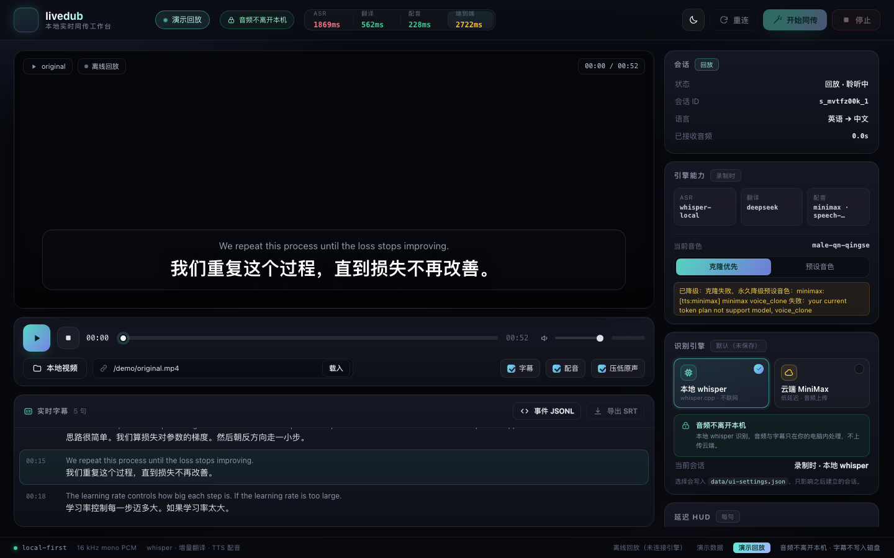

# livedub · real-time lecture interpretation

> **Local-first simultaneous interpretation for videos** — streaming ASR → incremental
> translation → cloned-voice dubbing + bilingual subtitles, built for lecture videos
> (MOOCs, university courses, tech talks).

[简体中文](README.md) | English

[](https://github.com/LeoLin990405/livedub/actions/workflows/ci.yml)
[](LICENSE)
[](package.json)
[](package.json)




## What it does

Watching an English lecture? livedub captures the audio, transcribes it on-device with
whisper, translates it incrementally with a streaming LLM, and speaks the translation in
Chinese — while showing bilingual subtitles and ducking the original audio.

Two surfaces:

- **Chrome extension** (MV3, `tabCapture`) — any web video (YouTube, Bilibili, Coursera,
  edX, Udemy, university portals, local `file://`); since v0.3 iframe/WebAudio players get
  original-audio ducking too.
- **Local workbench** (`studio/`) — local course video with live subtitles + dub, glossary,
  SRT/event export, local/cloud ASR switch, session replay.
- **macOS desktop overlay** (`apps/macos/`) — ScreenCaptureKit captures system/app audio and
  shows a floating bilingual subtitle panel + Chinese dub over Zoom/Meetings/players.
- **Offline batch** (`scripts/batch.mjs`) — video → dubbed MP4 with burned-in bilingual
  subtitles + SRT + replayable event stream.

Measured on this machine (Apple M2 / 16GB, 52.7s demo lecture, real providers):

| Stage | Measured |
|---|---|
| ASR — default (local whisper large-v3-turbo) | final text ~1.8s after speech ends |
| ASR — cloud profile (MiniMax asr-1.0) / fast profile (local small) | ~0.95s / ~0.9s |
| Translation (deepseek-flash streaming) | first token ~0.8s |
| TTS (MiniMax speech-2.8-hd streaming PCM) | first audio ~0.2s |
| **End-to-end** (speech end → Chinese dub playable) | **~3.0s** default · **~2.4s** fast · **~2.2–2.4s** cloud |

Full numbers: [docs/MEASUREMENTS.md](docs/MEASUREMENTS.md) (Chinese).

## Quick start

```bash
# Requirements: macOS (primary), Node >= 22, ffmpeg, whisper-cli/whisper-server
brew install ffmpeg whisper-cpp
curl -L -o models/ggml-large-v3-turbo-q5_0.bin \
  https://huggingface.co/ggerganov/whisper.cpp/resolve/main/ggml-large-v3-turbo-q5_0.bin

npm run doctor   # environment check (read-only)
npm test         # offline unit tests
npm start        # engine + workbench: http://127.0.0.1:8787/studio/
```

Translation/TTS providers are configured in `config/livedub.config.json`; credentials are
read read-only from `~/.sayless/config.json` (a local voice-engine config) or
`LIVEDUB_PROVIDER_<NAME>_API_KEY` env vars. Nothing is written back, nothing is logged.

Chrome extension: `chrome://extensions` → enable Developer mode → **Load unpacked** →
select `extension/`. Open a video, click the icon (tabCapture requires this gesture).

Generate the demo end-to-end:

```bash
npm run demo:video   # creates demo/original.mp4 (synthetic English lecture)
npm run batch        # real pipeline -> demo/dubbed.mp4 + bilingual.srt + session.jsonl
npm run batch:fast   # fast profile (small local ASR) -> demo-fast/
npm run batch:cloud  # cloud ASR profile (MiniMax, audio is uploaded) -> demo-cloud/

# macOS desktop overlay (system/app audio, ScreenCaptureKit)
bash scripts/build-macos.sh && open apps/macos/build/livedub.app
```

## Architecture

```text
Browser tab / local video
  │ 16kHz PCM over WebSocket
  ▼
Local engine (127.0.0.1:8787, zero npm deps)
  ├─ VAD segmentation + local whisper-server (persistent, on-device)
  ├─ streaming translation (OpenAI-compatible; deepseek by default, failover chain)
  ├─ streaming TTS (MiniMax speech-2.8-hd; voice-clone first, graceful fallback)
  ├─ scheduler (catch-up policy) + metrics
  └─ WebSocket events: partial / segment / translation / dub / metrics
  ▼
Subtitles overlay + dubbed audio + original-audio ducking
```

- Time base: 16kHz mono s16le, all events on a session timeline in milliseconds.
- Interface contract: [docs/CONTRACTS.md](docs/CONTRACTS.md).
- Design & latency budget: [docs/ARCHITECTURE.md](docs/ARCHITECTURE.md).
- Providers & voice cloning: [docs/PROVIDERS.md](docs/PROVIDERS.md).

## Why "like the original voice"?

1. **On-device ASR**: whisper runs locally, audio never leaves the machine.
2. **Incremental translation**: tokens stream to subtitles/TTS; the first clause is spoken
   before the whole sentence is translated.
3. **Voice-clone first**: the session collects lecturer speech and tries to clone the voice
   once; if the TTS plan doesn't support cloning (as with MiniMax Token plans), it degrades
   to a high-quality preset voice and keeps interpreting — never blocks the pipeline.
4. **Ducking & scheduling**: original audio drops to 18% while the dub plays; late audio is
   accelerated or dropped by policy.

## Limitations (honest)

- Latency profiles: default ~3.0s, `npm run start:fast` (small local ASR) ~2.4s,
  `npm run start:cloud` (MiniMax cloud ASR, audio uploaded) ~2.2–2.4s.
- Voice cloning requires a TTS plan that supports it (current MiniMax token plan returns
  code 2061; graceful fallback implemented).
- Chrome `tabCapture` requires a user gesture and cannot be automated; DRM-protected media
  may not be capturable. Native-fullscreen overlay support is best-effort.
- Original-audio ducking only works for top-frame HTML media elements (iframe players and
  WebAudio-based players are not ducked).
- macOS only for `say` fallback and the `whisper-server` workflow; Linux CI runs unit tests
  only.

## Open source

MIT licensed. See [CONTRIBUTING.md](CONTRIBUTING.md), [SECURITY.md](SECURITY.md),
[CODE_OF_CONDUCT.md](CODE_OF_CONDUCT.md), and [CHANGELOG.md](CHANGELOG.md).
Runtime has **zero npm dependencies** — Node built-ins only; tests use `node:test`.

Roadmap: [docs/ROADMAP.md](docs/ROADMAP.md).
