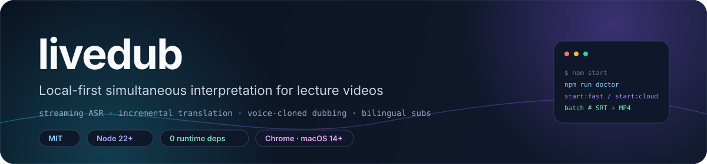
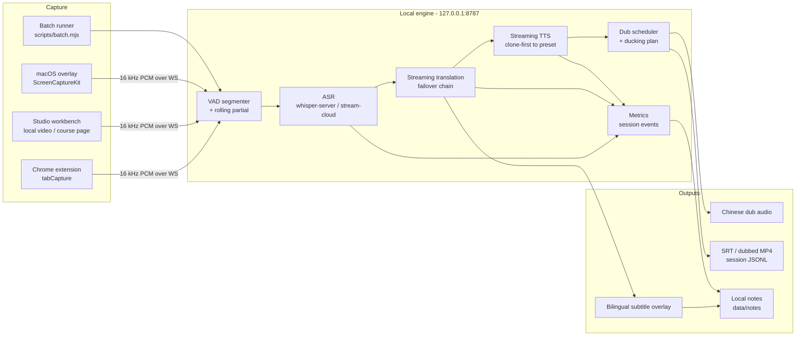
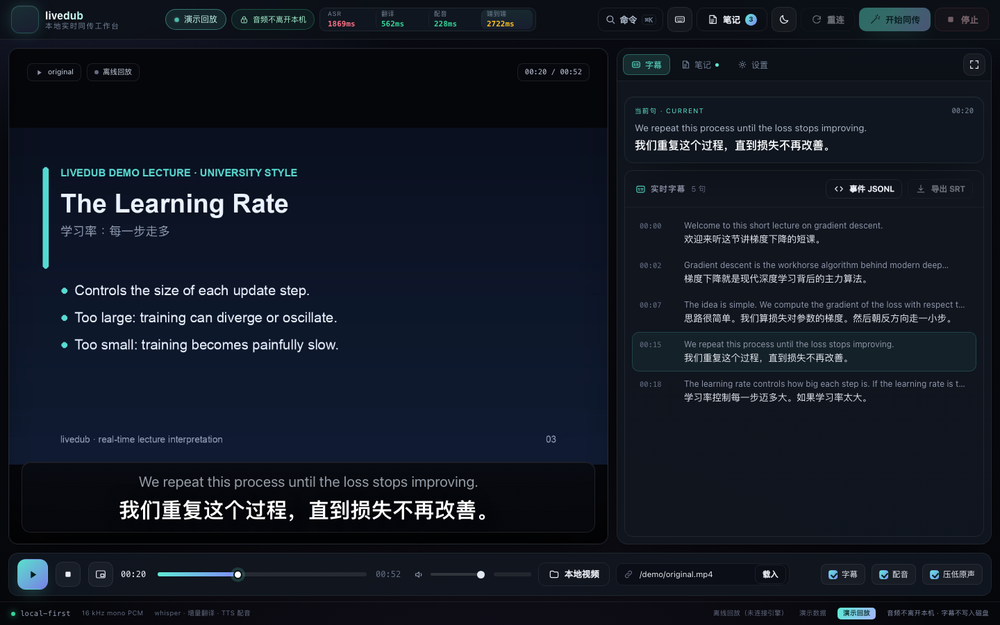
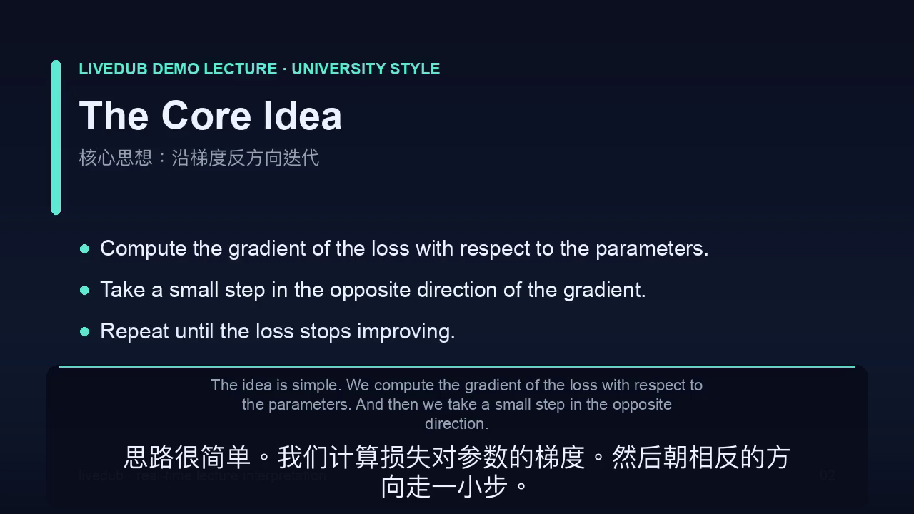
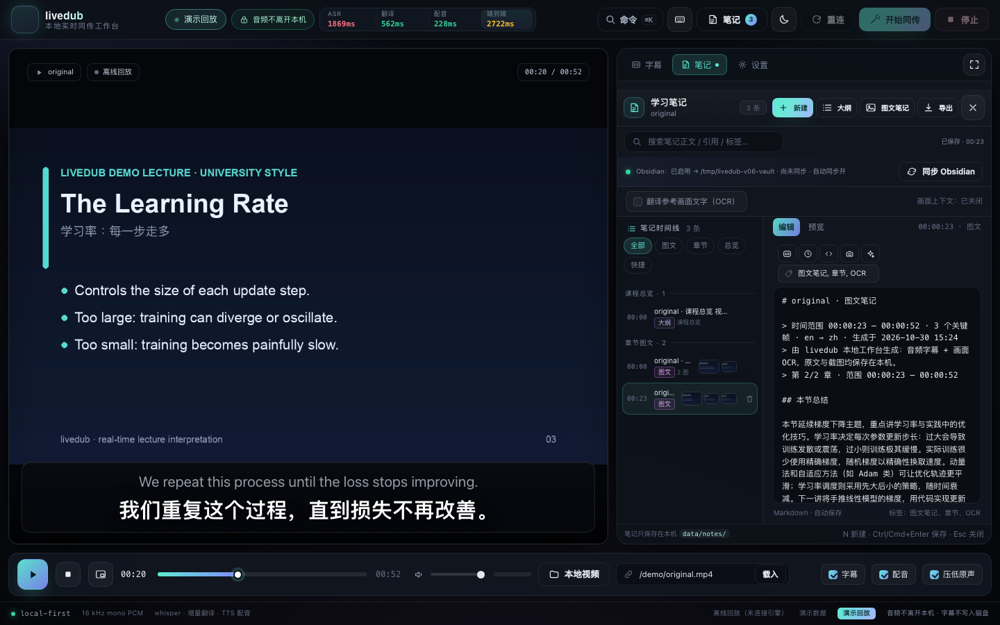
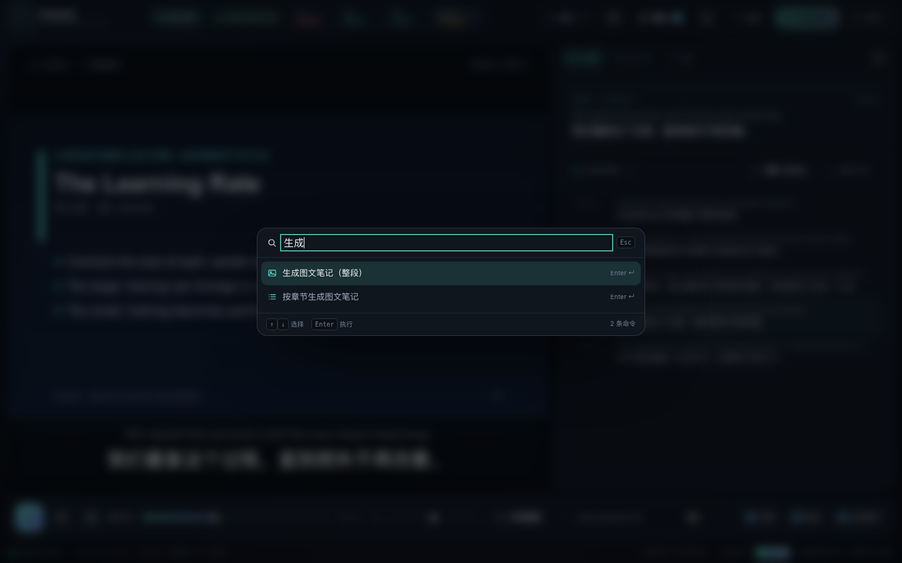
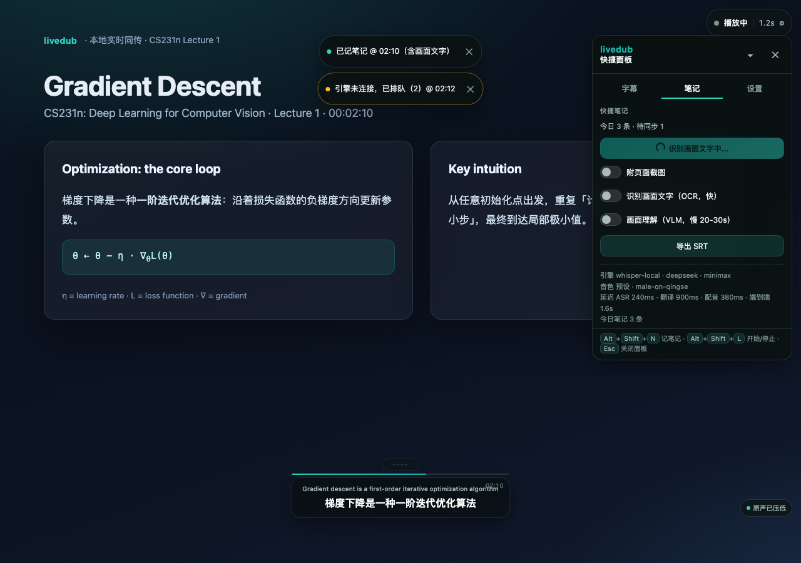
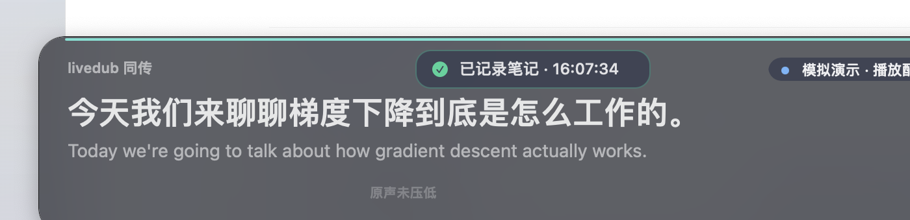

<div align="center">



# livedub

**Local-first simultaneous interpretation for lecture videos.**

Streaming ASR · incremental translation · cloned-voice dubbing · bilingual subtitles · local study notes

[**简体中文**](README.zh-CN.md) · **English**

<a href="LICENSE"></a>
<a href="package.json"></a>
<a href="package.json"></a>
<a href="extension/README.md"></a>
<a href="apps/macos/README.md"></a>
<a href=".github/workflows/ci.yml"></a>

</div>

> [!NOTE]
> **Current state.** v0.7.0 (2026-10-30) contains the Node engine, Chrome MV3 extension, local studio,
> macOS overlay, offline batch pipeline, and the notes/visual-note stack. Latency figures here are
> single-machine measurements from this repository, not service guarantees.

## ✨ Features

- **Local ASR by default.** `whisper-server` keeps the `large-v3-turbo-q5` model resident; audio does
  not leave the machine unless the cloud profile is selected.
- **Incremental translation.** Every finalized speech segment is sent to an OpenAI-compatible
  streaming LLM; `translate.chain` supplies an ordered failover list.
- **Clause-level TTS.** Long sentences are split by punctuation and length, and synthesis starts on
  the first stable clause instead of waiting for the full translation.
- **Clone-first voice handling.** A session collects at least 12s of lecturer speech, tries the
  configured clone chain (MiniMax, then Volcengine), records a failure once, and continues with a
  preset voice.
- **Bilingual subtitles and ducking.** The translation is drawn under the source line; the browser
  and studio lower the original to 18% while a dub chunk plays. The macOS overlay cannot mute
  system audio, so its original and dub play together.
- **Four capture surfaces.** A Chrome extension for tab audio, a local studio for files and course
  pages, a macOS overlay for system audio, and a batch runner for offline output.
- **Study notes.** Notes carry video timestamps, bilingual quotes, screenshots and code blocks, and
  export to Markdown with a course outline. All three UIs and a CLI can create them.
- **Visual notes and chapters.** Keyframe sampling plus local macOS Vision OCR (optional VLM)
  produces visual notes; chapter mode segments a course by caption gaps and frame changes and keeps
  a course overview.
- **Obsidian sync.** Markdown, screenshot assets and an index file are exported to a configured
  vault, with debounced auto-sync after note changes.
- **Zero npm runtime dependencies.** The Node engine and browser clients ship no third-party packages;
  tests use `node:test`.

## 🧠 Architecture



Capture clients send 16 kHz mono s16le PCM in 100 ms frames over a local WebSocket (`/ws`). The
engine keeps a per-session timeline in milliseconds, runs VAD and whisper, streams translation
tokens, and emits `partial`, `segment`, `translation`, `dub`, `metrics`, and `error` events. Clients
schedule dub chunks by `startMs` and duck the original while speaking. The wire contract is
[`docs/CONTRACTS.md`](docs/CONTRACTS.md); module layout and failure modes are in
[`docs/ARCHITECTURE.md`](docs/ARCHITECTURE.md).

## 🚀 Quick start

**Requirements:** macOS is the primary platform (Linux is used for CI tests); Node.js **≥ 22**;
`ffmpeg` / `ffprobe`; a `whisper-server` binary with a ggml model. The macOS overlay needs macOS 14+
and Swift 5.10 Command Line Tools. Translation and TTS need provider credentials.

```sh
git clone https://github.com/LeoLin990405/livedub.git
cd livedub
brew install ffmpeg whisper-cpp
mkdir -p models
curl -L -o models/ggml-large-v3-turbo-q5_0.bin \
  https://huggingface.co/ggerganov/whisper.cpp/resolve/main/ggml-large-v3-turbo-q5_0.bin
npm run doctor          # read-only environment check
npm start               # engine + studio on http://127.0.0.1:8787/studio/
```

Open `http://127.0.0.1:8787/studio/` and pick a local course video, or paste a course page or direct
media URL. Direct `mp4` / `webm` / `mp3` files go to the player; course pages yield a title, any
directly playable media, and timed captions.

Chrome extension: open `chrome://extensions`, enable **Developer mode**, choose **Load unpacked**, and
select `extension/`. Start playback, click the livedub icon, then click start — `tabCapture` requires
that user gesture. macOS overlay:

```sh
bash scripts/build-macos.sh          # -> apps/macos/build/livedub.app
open apps/macos/build/livedub.app
```

Offline batch: `npm run batch` runs the real pipeline over `demo/original.mp4` and writes
`demo/dubbed.mp4`, `demo/bilingual.srt`, `demo/session.jsonl`, and `demo/metrics.json`.

> [!TIP]
> Provider keys are read read-only from `~/.sayless/config.json`, from `providers` in
> `config/livedub.config.json`, or from `LIVEDUB_PROVIDER_<NAME>_API_KEY`. The engine does not write
> keys back and does not log them. `npm run doctor --probe` performs one small real request.

## 🗂️ Surfaces and profiles

| Surface | Start with | What it handles |
|---|---|---|
| **Chrome extension** (MV3) | `npm start` + load `extension/` | Audio from any tab; `tabCapture` needs a click; iframe/WebAudio players get ducking |
| **Studio workbench** | `npm start` → `/studio/` | Local video, direct media URLs, course pages with timed captions, replay, SRT export |
| **macOS overlay** | `bash scripts/build-macos.sh` | System audio (display mix) through ScreenCaptureKit, floating bilingual panel, Chinese dub |
| **Offline batch** | `npm run batch` | Burned-in bilingual subtitles, mixed dub, SRT/JSONL/metrics artifacts |
| **Notes CLI** | `npm run note -- "..."` | Timestamped quick note; falls back to `data/notes/` when the engine is offline |

| Profile | Command | ASR backend | Repo-measured e2e |
|---|---|---|---|
| **Quality** (default) | `npm start` / `npm run batch` | local `whisper-server`, `large-v3-turbo-q5` | ~3.0 s |
| **Fast** | `npm run start:fast` / `npm run batch:fast` | local whisper `small` | ~2.4 s |
| **Cloud** | `npm run start:cloud` / `npm run batch:cloud` | `stream-cloud`, local whisper fallback | audio upload; see note |

> [!WARNING]
> The cloud profile sends audio to a remote ASR service. The ~2.2–2.4 s cloud figures in
> `docs/MEASUREMENTS.md` were collected with the earlier MiniMax `asr-1.0` upload provider, not with
> the current `stream-cloud` chain.

## 🎙️ Providers and voice cloning

| Stage | Default | Options in the repository | Notes |
|---|---|---|---|
| **ASR** | local `whisper-server` (`large-v3-turbo-q5`) | whisper `small`, `stream-cloud`, `minimax-cloud`, `mock` | Cloud variants upload audio; the cloud profile falls back to local whisper |
| **Translation** | `deepseek` (`deepseek-flash`) | `minimax`, `mimo-plan`, `zai`, `ark-plan` | OpenAI-compatible streaming; ordered `translate.chain` failover |
| **TTS** | MiniMax `speech-2.8-hd` | `macos-say`, `mock` | PCM streaming with warmup and an LRU cache |
| **Voice cloning** | MiniMax clone, then Volcengine v3 | preset voices | MiniMax Token Plan returns 2061; Volcengine needs a Doubao Speech UUID key |

Configuration precedence and full provider setup are documented in
[`docs/PROVIDERS.md`](docs/PROVIDERS.md). Clone mode is `clone-first`: clone when the plan allows it,
otherwise keep interpreting with a preset voice. A clone failure is recorded once per session and
is not retried for every sentence.

## 📝 Notes, chapters and visual context

Notes live under `data/notes/`; the `/api/notes` endpoints listen on `127.0.0.1` only. The studio
uses `N` for a new note, the extension uses `Alt+Shift+N`, the macOS overlay uses `⌥N`, and the CLI
uses `npm run note -- "..."`.

- **Timestamped quotes.** A note stores `t0Ms` / `t1Ms` with the source and translated sentence;
  clicking a note seeks the player back to that moment.
- **Visual notes.** Keyframes are sampled every 6 s, deduplicated on a 64×36 grayscale diff (max 24
  frames), OCR'd with local macOS Vision (tesseract fallback, English only), and summarized with the
  transcript. The optional VLM path is off by default and takes roughly 20–30 s per frame.
- **Chapter mode.** Caption gaps over 2.5 s or frame changes split a course into 20–180 s chapters
  (max 30), generate one visual note per chapter, and maintain a course overview with time anchors.
- **Obsidian sync.** Configure `notes.obsidian` with a vault directory, `assetsSubdir`, and
  `autoExport`; notes export as Markdown plus screenshots and `livedub-notes-index.md`.
- **Visual context for translation.** When enabled, the studio or macOS app pushes OCR text every
  8–10 s; the engine keeps the latest entry for 120 s and injects it as terminology/context only.

| Studio workbench (v0.7, dark) | Dubbed output: Chinese voice + burned subtitles |
|---|---|
|  |  |

| Notes workspace | Command palette (`⌘K`) |
|---|---|
|  |  |

| Chrome subtitle overlay | macOS floating overlay |
|---|---|
|  |  |

The full screenshot set, notes workflow, Obsidian example, and troubleshooting table live in
[`docs/usage.md`](docs/usage.md).

## 📊 Measured latency

| Stage | Quality (default) | Fast | Cloud (MiniMax `asr-1.0` runs) |
|---|---|---|---|
| ASR final text | 1837 ms | 922 ms | 954 / 1124 ms |
| Translation first token | 802 ms | 890 ms | 797 / 1213 ms |
| TTS first packet | 253 ms | 313 ms | 243 / 219 ms |
| **End-to-end** | **3001 ms** | **2389 ms** | **2204 / 2385 ms** |

Medians from [`docs/MEASUREMENTS.md`](docs/MEASUREMENTS.md): a 52.7 s synthetic lecture with 12
sentences, fed at 1× realtime on an Apple M2 / 16 GB host. Quality and fast used one clean run each;
cloud used two runs. The same document reports ±10–20% run-to-run variation from network and load.

## 📁 Repository layout

| Path | Contents |
|---|---|
| `engine/` | Node engine: protocol, session pipeline, ASR, segmenter, translation, TTS, voice, scheduler, WebSocket server |
| `studio/` | Local workbench (HTML/JS, no build step) with player, subtitle stage, notes workspace and replay |
| `extension/` | Chrome MV3 extension: tab capture, offscreen audio, subtitle overlay, popup, notes |
| `apps/macos/` | Swift menu-bar app and floating overlay (ScreenCaptureKit, AVFoundation, AppKit) |
| `scripts/` | `doctor`, `batch`, demo generation, note CLI, macOS build, OCR build |
| `tests/` | `node:test` suites: unit, mock end-to-end, extension/studio/macOS static contracts |
| `config/` | Base configuration plus `livedub.fast.json` and `livedub.cloud.json` overrides |
| `docs/` | Contracts, architecture, measurements, providers, notes, design, roadmap, usage reference |
| `demo/` | Synthetic English lecture and real pipeline outputs (MP4, SRT, JSONL, metrics) |
| `data/` | Generated notes and exports; gitignored |
| `LICENSE`, `CHANGELOG.md` | MIT license text and release history |

Project home: [github.com/LeoLin990405/livedub](https://github.com/LeoLin990405/livedub) ·
Releases: [GitHub Releases](https://github.com/LeoLin990405/livedub/releases).

## 🛠️ Development

```sh
npm run doctor          # read-only environment probe
npm test                # offline node:test suites
npm run lint            # syntax check for all JS
npm run check           # lint + tests

LIVEDUB_INTEGRATION=1 node --test tests/asr.test.mjs
LIVEDUB_INTEGRATION=1 node --test tests/tts.test.mjs
```

The CI workflow [`.github/workflows/ci.yml`](.github/workflows/ci.yml) runs lint and the offline unit
suite on Node 22 and 24, a non-fatal doctor probe, a contract-doc presence check, a basic secret scan,
and a macOS Swift build check. Runtime code and tests have no npm dependencies. The optional
integration tests start real whisper or call real providers and are skipped by default.

## 🧭 Scope, limits and roadmap

livedub is a local tool for lecture-style video. It does not provide accounts, cloud storage, or DRM
handling, and it does not claim production-scale multi-user behavior.

- **Platform.** macOS is the primary platform. The desktop overlay needs macOS 14+; Linux CI runs the
  test suite but cannot exercise tab capture, system audio capture, or `say` fallback.
- **Tab capture.** Chrome `tabCapture` requires a user gesture and cannot be automated; DRM-protected
  media may not be capturable.
- **System audio.** ScreenCaptureKit cannot mute the original system output, so the macOS overlay
  plays its dub alongside the original. Ducking exists only in the browser and studio clients.
- **Voice cloning.** Cloning depends on a TTS plan that supports it. MiniMax Token Plan returns error
  2061 and falls back to a preset; Volcengine requires a Doubao Speech UUID key, not an Ark key.
- **Cloud ASR.** The cloud profile uploads audio to the provider. Local whisper keeps audio on device.
  Visual context and VLM captions can send OCR text or screenshots to configured cloud providers.
- **Partial captions.** ASR partial is off by default; the repo's A/B measured about +0.8 s end-to-end
  when enabled, because partial inference shares the whisper queue.
- **Latency.** The figures above are medians from one machine and one 52.7 s clip. There is no
  sub-2-second guarantee for a full-length lecture; weak networks favor subtitles without dubbing.
- **Notes sync.** Obsidian sync is a one-way export. Notes stay on the local machine unless the user
  puts `data/notes/` into their own sync folder.

Roadmap:

- [ ] Add desktop-level ducking through a virtual audio device on macOS
- [ ] Continue reducing end-to-end latency without promising a fixed bound
- [ ] Publish through the Chrome Web Store and a signed/notarized Homebrew Cask
- [ ] Improve glossary import and formula/code handling
- [ ] Add bidirectional Obsidian/Notion sync and multi-device notes
- [ ] Run real-device latency regression baselines on a macOS CI runner

## 🤝 Contributing

Issues and pull requests are welcome. Before opening a PR:

1. run `npm test`, `npm run lint`, and `npm run check`;
2. do not commit API keys, personal paths, model weights, or `demo/tmp/` artifacts;
3. update [`docs/CONTRACTS.md`](docs/CONTRACTS.md) when a cross-module interface changes.

Read [`CONTRIBUTING.md`](CONTRIBUTING.md) for code conventions. Report security issues privately as
described in [`SECURITY.md`](SECURITY.md); do not open a public issue for them.

If livedub is useful to you, consider leaving a ⭐ — it helps others find the project.

## 📄 License and attribution

livedub is licensed under the [MIT License](LICENSE), copyright (c) 2026 livedub contributors. No
NOTICE file is included. The engine reuses provider credentials from `~/.sayless/config.json`
read-only; sayless is an independent local voice-engine project and livedub is not affiliated with
it. Whisper ggml model weights and third-party media are not bundled; the demo media is synthetic.

## ⭐ Star history

<div align="center">

<a href="https://star-history.com/#LeoLin990405/livedub&Date">
  
</a>

</div>
