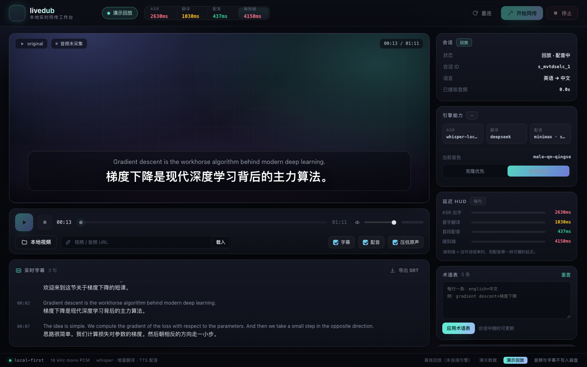
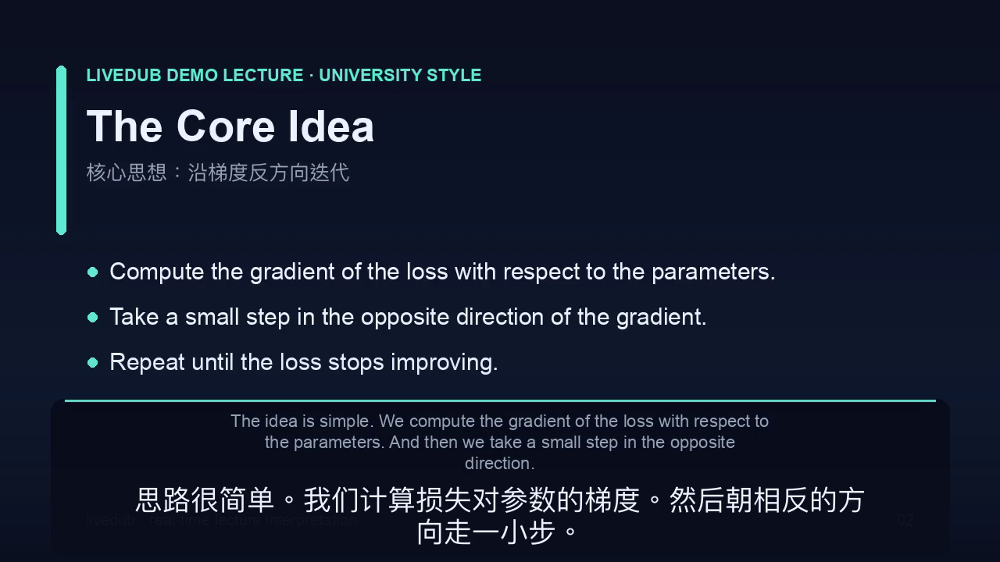
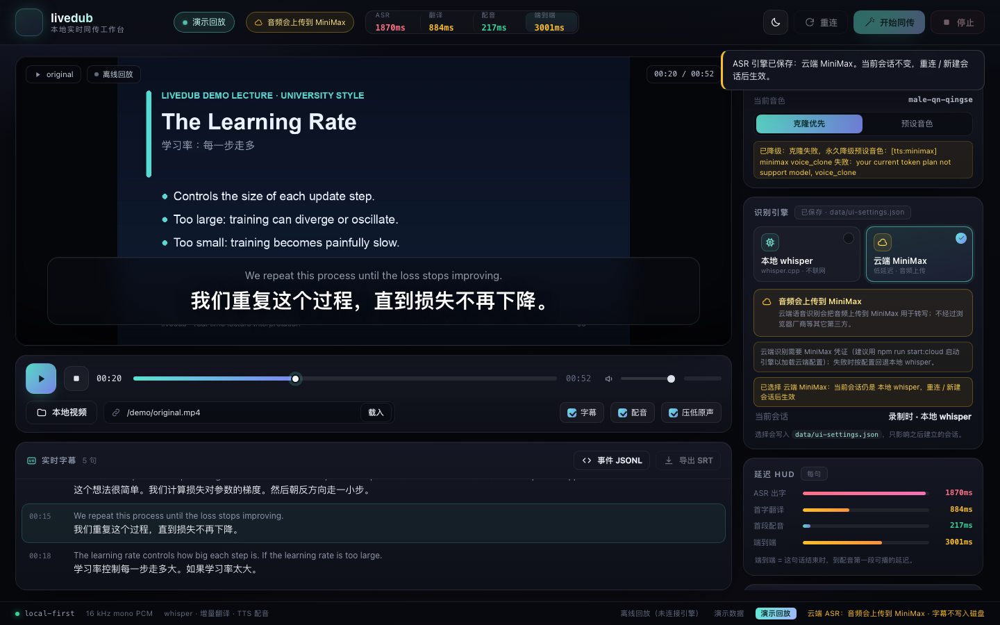
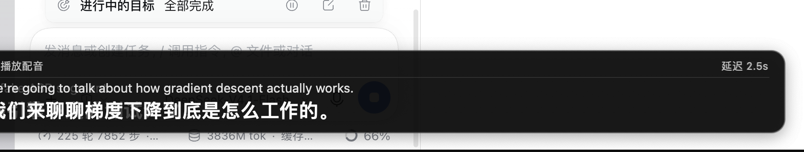
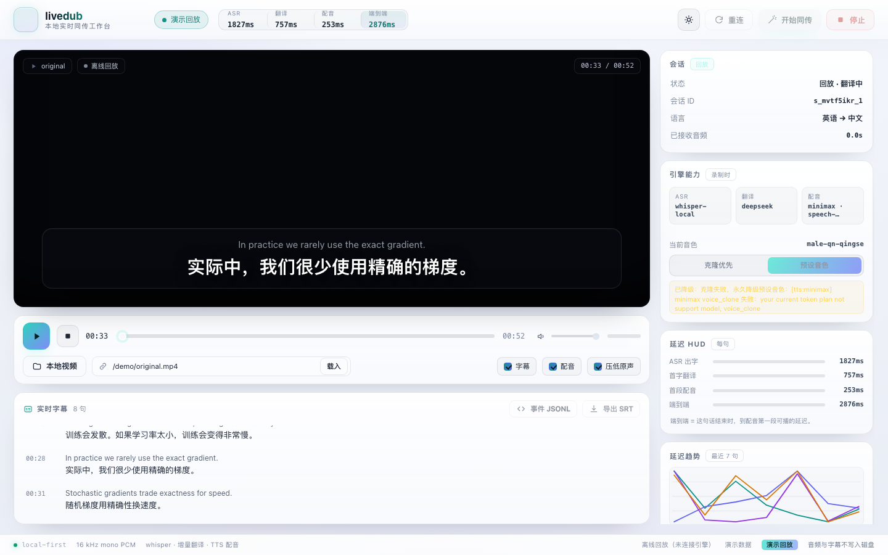
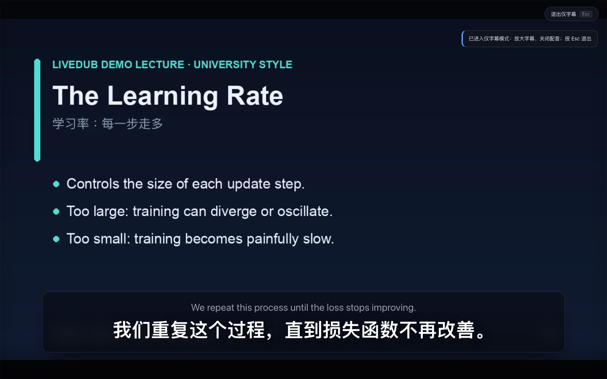
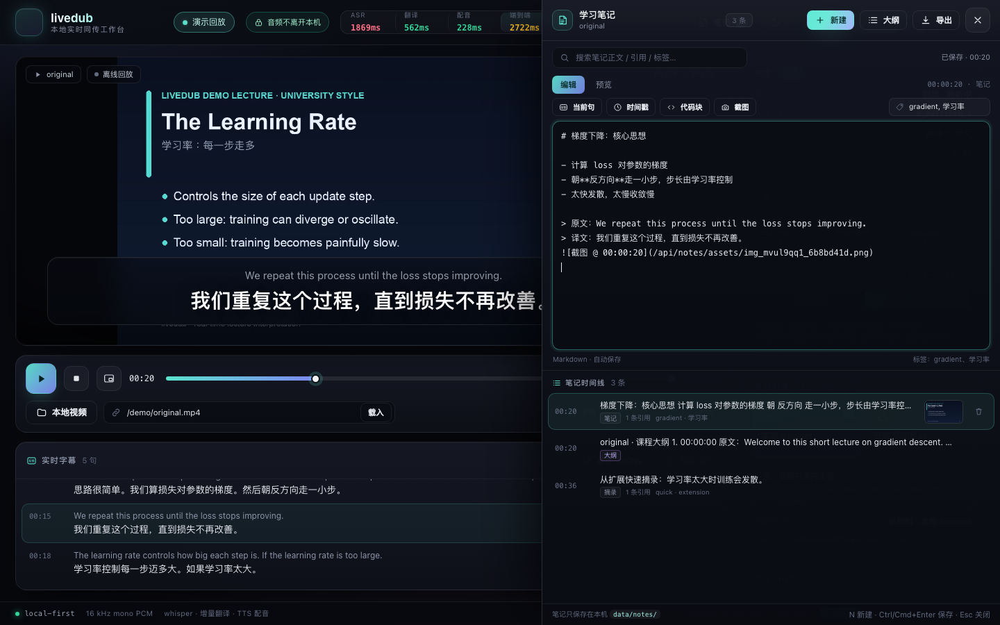
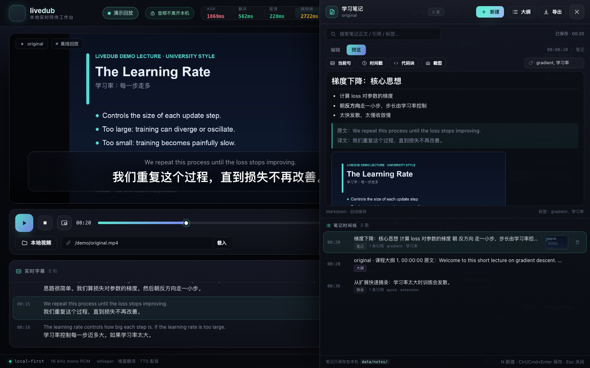

# livedub · 看视频，像原声一样同传

[简体中文](README.md) | [English](README.en.md)

[](https://github.com/LeoLin990405/livedub/actions/workflows/ci.yml)
[](LICENSE)
[](package.json)
[](package.json)
[](https://github.com/LeoLin990405/livedub/releases)
[](https://github.com/LeoLin990405/livedub)

> 本地优先的**实时同声传译引擎**：抓取视频声音 → 流式识别 → 增量翻译 → 克隆音色配音 + 双语字幕。
> 面向**教学视频**（公开课/网课/技术讲座）优化：术语表约束、子句级低延迟配音、原声自动压音。
>

**v0.3（2026-10-29）**：新增 **云端 ASR（MiniMax，e2e ~2.2s）**、**火山引擎 TTS + 声音复刻（真正原声克隆）**、
**macOS 桌面悬浮窗（ScreenCaptureKit，覆盖 Zoom/会议/播放器）**、扩展**全局限定压音**（iframe/WebAudio 可压）、
**裸 video 全屏叠加**；工作台支持本地/云端 ASR 切换与隐私提示。v0.2 的翻译×TTS 重叠、TTS 缓存、三档延迟等见 [CHANGELOG](CHANGELOG.md)。
> 形态：Chrome 扩展（任意网页视频） + 本地工作台（本地课程文件 / 回放 / 导出）。

```text
YouTube / B站 / 网课页面       本地引擎 (127.0.0.1)               输出
┌──────────────────┐   16k PCM   ┌───────────────────────────┐   ┌──────────────────────────┐
│ Chrome 扩展       │ ──────────▶ │ 流式 ASR（本地 whisper）    │   │ 页面浮层：英/中双语字幕     │
│ tabCapture 抓声音 │             │ → 增量翻译（deepseek 流式） │──▶│ 中文配音（克隆音色，失败降级）│
│ 本地工作台        │ ◀────────── │ → 流式 TTS（MiniMax）       │   │ 原声自动压低（ducking）     │
└──────────────────┘   WS 事件    │ → 调度/压音/字幕/指标        │   └──────────────────────────┘
                                  └───────────────────────────┘
       实测：语音结束后 ~3.0s（快速档 ~2.4s / 云端档 ~2.2s）出中文配音，见 docs/MEASUREMENTS.md
```

## 它解决什么问题

看英文公开课时，字幕软件只给「延迟 1-2 秒的整句字幕」，听不懂还是听不懂。livedub 做三件事：

1. **双语字幕**：原文下方直接给中文，分句粒度、边听边出；
2. **中文配音**：「像同传耳机一样」用中文音色朗读译文，可选手压原声，眼睛可以离开字幕；
3. **教学场景优化**：术语表（`gradient descent → 梯度下降`）强约束；公式/代码标识符不翻译；一句太长会按子句切块先出声，不让用户干等。

## 真实能力（已在本机实测）

| 环节 | 实现 | 实测 |
|---|---|---|
| ASR | 本地 `whisper-server`（large-v3-turbo q5，常驻进程） | 29.4s 音频热推理 **≈1.4s**（RTF≈0.05），离线、不上传声音 |
| 翻译 | OpenAI 兼容流式 LLM，默认 `deepseek-flash`，可配置 failover 链 | 首字 **≈1.0s** |
| TTS | MiniMax `speech-2.8-hd` 流式（PCM），默认男声讲师音色 | 短句首包 **≈1.1–1.5s** |
| 音色克隆 | 火山声音复刻 v3 / MiniMax / 自动降级 preset | 协议已实现（火山需豆包语音 UUID Key，目前本机无此 Key，真机验证了 401→降级路径）；MiniMax Token Plan 返回 2061 自动降级 |
| 云端 ASR | MiniMax `asr-1.0`（`npm run start:cloud`） | 4s≈0.79s / 12s≈1.0-1.2s；**云端档 e2e ≈2.2–2.4s**，音频会上传、失败自动降级本地 |
| 学习笔记 | 时间戳 + 双语引用 + 截图 + 代码块 + 大纲；三端快捷记录（工作台 `N`、扩展 `Alt+Shift+N`、桌面 `⌥N`、CLI） | 笔记只落本机 `data/notes/`，导出 Markdown 可直接进 Obsidian（见 [docs/NOTES.md](docs/NOTES.md)） |
| 桌面端 | macOS 原生悬浮窗（ScreenCaptureKit） | `apps/macos/` 源码 + `scripts/build-macos.sh`（见 [apps/macos/README.md](apps/macos/README.md)） |
| 管线 | Node 零依赖引擎，VAD 切分 + 子句级 TTS + 调度压音 | 52.7s 示例课实测：**质量档 e2e 3.0s** / **快速档 2.4s**（ASR 1.8s→0.9s、翻译首字 0.8s、TTS 首包 0.25s；[完整数据](docs/MEASUREMENTS.md)） |

> ⚠️ 声音克隆能力取决于你的 TTS 服务套餐（MiniMax 按量付费 / 火山语音复刻等）。livedub 的原则是：**克隆能通就用克隆，不能通也保证同传可用**，不会因为克隆失败让整条链路挂掉。

## 看一眼（真实产物）

| 本地工作台（真实链路回放，HUD 为实测延迟） | 成片：中文配音 + 烧录双语字幕 |
|---|---|
|  |  |

| 本地/云端 ASR 切换 + 隐私提示 | macOS 桌面悬浮窗（任意应用之上） |
|---|---|
|  |  |

| 亮色主题 | 仅字幕模式 |
|---|---|
|  |  |

- 完整演示视频：`demo/dubbed.mp4`（原声自动压低 + 中文 AI 配音 + 双语字幕）
- 原始英文视频：`demo/original.mp4`；双语字幕：`demo/bilingual.srt`；回放事件流：`demo/session.jsonl`
- 更多截图与产物说明：[demo/README.md](demo/README.md)

## 快速开始

### 0. 依赖

- macOS（Apple Silicon 推荐），Node.js **≥ 22**
- `ffmpeg` / `ffprobe`（`brew install ffmpeg`）
- `whisper-server` + 模型
  ```bash
  brew install whisper-cpp
  # 模型（约 547MB，放到项目 models/ 下；或改 config.asr.whisper.models 指向已有模型）
  curl -L -o models/ggml-large-v3-turbo-q5_0.bin \
    https://huggingface.co/ggerganov/whisper.cpp/resolve/main/ggml-large-v3-turbo-q5_0.bin
  ```
- 翻译/TTS 的 API Key：默认复用你 `~/.sayless/config.json` 里已配置的 provider（只读）；也可以自己写进 `config/livedub.config.json` 的 `providers`，或用环境变量 `LIVEDUB_PROVIDER_<NAME>_API_KEY`。

### 1. 体检

```bash
cd livedub
npm run doctor              # 只读检查；--probe 会做一次极小样本真实探测
npm test                    # 零外部依赖单元测试
```

### 2. 本地工作台（最稳的试用方式）

```bash
npm start                   # 或 npm run studio（会打开浏览器）
# 打开 http://127.0.0.1:8787/studio/
```

选择一个本地课程视频 → 开始播放 → 你会看到双语字幕、听到中文配音、原声自动压低。
工作台还提供：延迟 HUD、术语表编辑、音色模式、导出双语 SRT。

### 3. Chrome 扩展（看任意网页视频）

1. Chrome 打开 `chrome://extensions` → 打开「开发者模式」→「加载已解压的扩展程序」→ 选 `extension/` 目录；
2. 打开 B站 / YouTube / 网课页面，点扩展图标开始（`tabCapture` 需要这次点击手势）；
3. 页面底部出现双语字幕浮层与状态胶囊；再点一次停止。
   排障见 `extension/README.md`。

### 4. 离线批处理 / 生成演示

```bash
npm run demo:video                   # 生成 demo/original.mp4（英文公开课示例）
npm run batch                        # 真实管线跑一遍 demo/original.mp4
# 产出：
#   demo/dubbed.mp4      原声压低 + 中文配音 + 烧录双语字幕
#   demo/bilingual.srt   双语字幕
#   demo/session.jsonl   引擎事件回放（studio/replay.html 可加载）
#   demo/metrics.json    每句延迟指标
```

回放（演示/截图用）：

```bash
npm start
# http://127.0.0.1:8787/replay/?session=/demo/session.jsonl&video=/demo/original.mp4
```

低延迟「快速档」（ASR 换 small 模型，实测 e2e **3.0s → 2.4s**，术语准确率略降）：

```bash
npm run start:fast      # 工作台，等价于 LIVEDUB_PROFILE=fast npm start
npm run batch:fast      # 成片批处理，输出到 demo-fast/
```

最低延迟「云端档」（ASR 走 MiniMax 云端，**e2e ~2.2–2.4s**；音频会上传，失败自动降级本地）：

```bash
npm run start:cloud     # 工作台，等价于 LIVEDUB_PROFILE=cloud npm start
npm run batch:cloud     # 成片批处理，输出到 demo-cloud/
```

macOS 桌面悬浮窗（抓系统/应用音频，覆盖 Zoom/腾讯会议/本地播放器）：

```bash
bash scripts/build-macos.sh   # 生成 apps/macos/build/livedub.app
open apps/macos/build/livedub.app
# 首次使用在 系统设置 → 隐私与安全 → 屏幕录制 中授权
```

完整实测数字、逐句延迟、模型对比见 [docs/MEASUREMENTS.md](docs/MEASUREMENTS.md)。

## 边看边实现 + 学习笔记（v0.4）

看视频 → 跟着敲代码 → 随时记笔记，互不打断：

```bash
# 1) 工作台里：画中画播放视频 + 右侧「学习笔记」面板（N 新建，插入当前句/截图/代码块，导出 Markdown）
npm start            # http://127.0.0.1:8787/studio/

# 2) 在 VSCode 里边看边实现：全局快捷键记录「当前这句字幕 + 时间戳」
#    Chrome 扩展：Alt+Shift+N     macOS App：⌥N

# 3) 终端/快捷键工具：一句话记进笔记库（引擎没启动会自动写本地 Markdown）
npm run note -- "反向传播 = 链式法则 + 计算图"
npm run note -- "这里为什么要 detach？" --video "MIT 6.S191" --time 12:34 --tag todo
```

- 笔记带**视频时间戳**，列表点击直接跳回对应画面；
- 自动附带**中英双语原句**、可插**视频截图**与**代码块**；
- 一键生成按时间轴的**课程大纲**，导出 Markdown（YAML front matter）到 `data/exports/`，可直接放进 Obsidian；
- 详细用法与隐私说明：[docs/NOTES.md](docs/NOTES.md)。

| 工作台笔记抽屉（真实会话 + 截图/大纲/快捷摘录） | Markdown 预览 |
|---|---|
|  |  |

## 目录结构

```text
livedub/
├── engine/                 本地引擎（Node，零依赖）
│   ├── protocol.mjs        线协议：WS 事件 + 二进制音频帧
│   ├── config.mjs          配置分层 + 复用 ~/.sayless providers
│   ├── pipeline.mjs        Session 编排：ASR→翻译→TTS→调度→事件
│   ├── asr/                流式 ASR（本地 whisper-server / mock）
│   ├── segmenter.mjs       VAD 切分/滚动 partial
│   ├── translate/          增量翻译（流式 LLM、术语、上下文、failover）
│   ├── subtitles.mjs       SRT / 双语排版 / CPS
│   ├── tts/                TTS（MiniMax 流式 / macOS say / mock）
│   ├── voice.mjs           克隆优先 → 自动降级
│   ├── dub/scheduler.mjs   配音调度（落后加速/丢弃策略）
│   ├── ws.mjs              极简 RFC6455 服务端
│   └── server.mjs          HTTP + WS + 静态工作台
├── studio/                 本地工作台（HTML/JS，零依赖，暗色 UI）
├── extension/              Chrome MV3 扩展（抓声 + 浮层 + 配音 + 全局限定压音）
├── apps/macos/             macOS 原生桌面悬浮窗（Swift + ScreenCaptureKit）
├── scripts/                doctor / batch / make-demo / 图层渲染
├── tests/                  node:test（含 mock 端到端）
├── config/                 livedub.config.json + fast/cloud 档位覆盖
└── docs/                   CONTRACTS / ARCHITECTURE / PROVIDERS / NOTES / ROADMAP / MEASUREMENTS
```

## 设计要点（为什么能做到「像原声」）

1. **本地 ASR 常驻**：whisper 模型常驻 `whisper-server`，VAD 按句切分 + 滚动 partial，句子结束 0.5–1s 内出最终文本；声音不出本机。
2. **增量翻译**：每句一拿到就流式翻译，译文 token 边到边推给字幕/配音，不等整段。
3. **子句级 TTS**：长句按标点/长度切块，第一块译完就开始合成，配音领先整句完成时间出声。
4. **音色克隆优雅降级**：会话开始收集讲师语音样本 → 尝试克隆 → 失败一次就记住原因并换 preset，不打断会话。
5. **调度与压音**：配音落后超过阈值时按策略加速（≤1.25x）或丢弃；原声在配音期间自动 duck 到 18%，视觉/听觉都不打架。

更完整的原理、时序和失败模式见 [docs/ARCHITECTURE.md](docs/ARCHITECTURE.md)；provider 与克隆开通方式见 [docs/PROVIDERS.md](docs/PROVIDERS.md)。

## 隐私

- ASR 默认**完全本地**（whisper），声音不出机器；
- 翻译/TTS 会把**文本**发给你配置的云服务（deepseek / MiniMax 等），是否使用由你配置决定；
- 引擎只监听 `127.0.0.1`，默认不落盘音频/转写（`privacy.persistAudio=false`）。

## 已知限制 / 下一步

- 声音克隆需要按量付费 TTS 套餐（见 `docs/PROVIDERS.md`）；当前默认 key 会降级为高质量 preset 音色。
- 扩展的 `tabCapture` 依赖用户手势，不能全自动启动；受 DRM 保护的页面可能抓不到声音。
- 默认关闭 ASR partial（会占用 whisper 队列拖慢 final，实测 +0.8s e2e）；想要「字幕边听边长」可在 config 开启 `asr.whisper.partial.enabled`。
- 实时字幕延迟受翻译/配音网络影响，弱网时建议关配音只用字幕。
- 计划：桌面悬浮窗（任意播放器/网课客户端）、云端流式 ASR 适配器、幻灯片 OCR 上下文、课程术语自动学习。详见 [docs/ROADMAP.md](docs/ROADMAP.md)。

## 开源

- 许可证：MIT（[LICENSE](LICENSE)）
- 贡献指南：[CONTRIBUTING.md](CONTRIBUTING.md) · 行为准则：[CODE_OF_CONDUCT.md](CODE_OF_CONDUCT.md)
- 安全报告：[SECURITY.md](SECURITY.md)（请勿公开 Issue）
- 变更历史：[CHANGELOG.md](CHANGELOG.md) · 路线图：[docs/ROADMAP.md](docs/ROADMAP.md)
- CI：GitHub Actions（Node 22/24；语法检查 + 离线单测 + 密钥扫描）
- 运行时**零 npm 依赖**（只用 Node 内置能力），测试用 `node:test`

欢迎 Issue / PR：尤其欢迎新的 TTS/ASR provider 适配器、桌面端（ScreenCaptureKit）实现、
以及真实课程场景的延迟/质量评测。

## 致谢与许可

- 复用用户已有的 `~/.sayless/config.json` provider 配置（只读）；`sayless` 为本地语音引擎项目，与本项目无隶属关系。
- MIT License。
