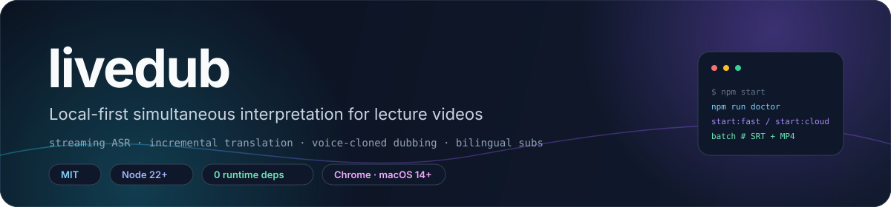
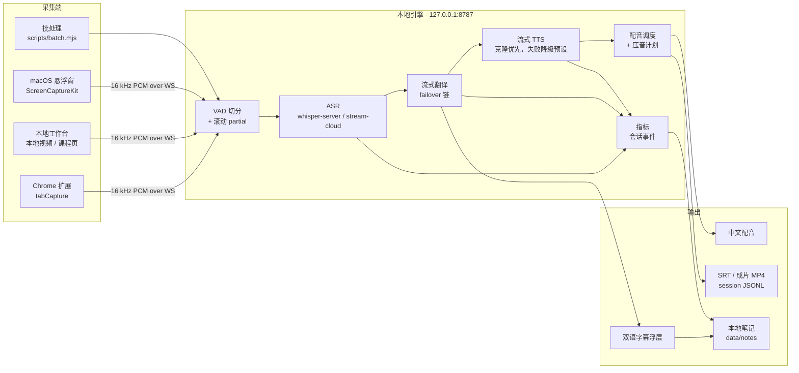
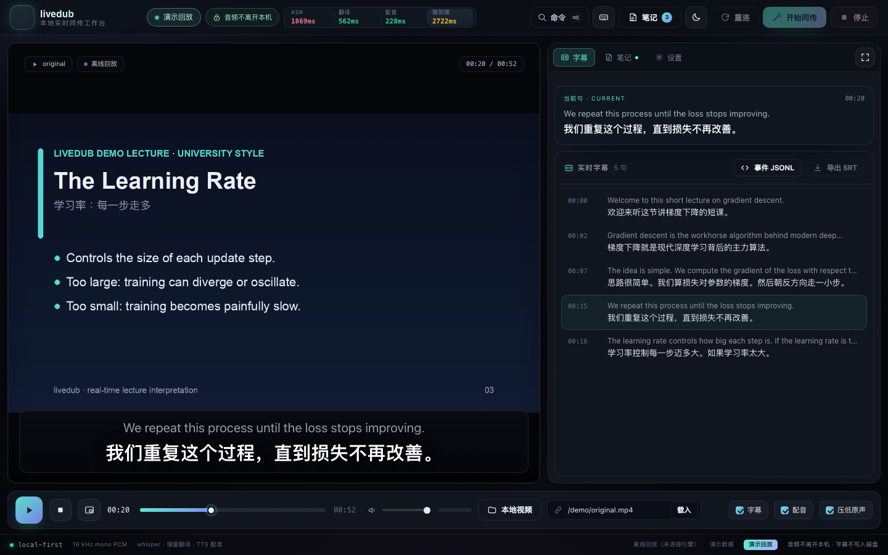
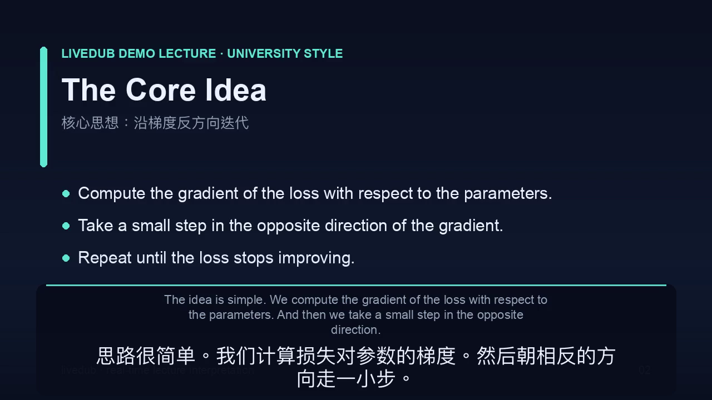
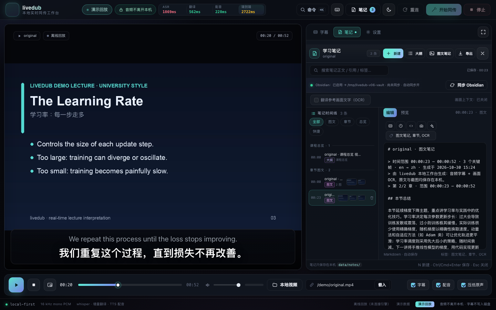
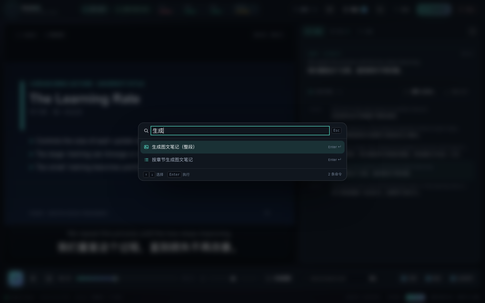
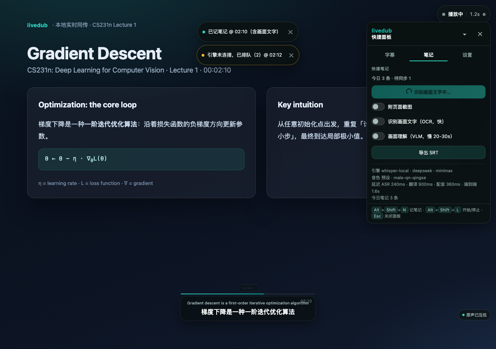
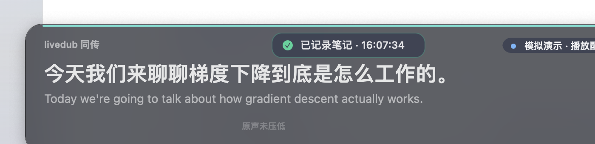

<div align="center">



# livedub

**面向教学视频的本地优先实时同声传译。**

流式 ASR · 增量翻译 · 克隆音色配音 · 双语字幕 · 本地学习笔记

**简体中文** · [**English**](README.md)

<a href="LICENSE"></a>
<a href="package.json"></a>
<a href="package.json"></a>
<a href="extension/README.md"></a>
<a href="apps/macos/README.md"></a>
<a href=".github/workflows/ci.yml"></a>

</div>

> [!NOTE]
> **当前状态。** v0.7.0（2026-10-30）包含 Node 引擎、Chrome MV3 扩展、本地工作台、macOS 悬浮窗、
> 离线批处理，以及笔记与图文笔记链路。文中的延迟数字都来自本仓库的单机实测，不是服务承诺。

## ✨ 特性

- **默认本地 ASR。** `whisper-server` 常驻加载 `large-v3-turbo-q5` 模型；不切到云端档时，声音不离开本机。
- **增量翻译。** 每个定稿语音段立即送入 OpenAI 兼容的流式 LLM；`translate.chain` 提供按顺序的 failover 列表。
- **子句级 TTS。** 长句按标点与长度切块，第一个稳定子句译完就开始合成，不等整句翻译结束。
- **克隆优先的音色处理。** 会话先收集至少 12s 讲师语音，按配置的克隆链（MiniMax → 火山）尝试；
  失败只记录一次原因，然后继续用预设音色同传。
- **双语字幕与原声压低。** 译文显示在原文下方；浏览器与工作台在配音播放时把原声降到 18%。
  macOS 悬浮窗无法静音系统音频，因此原声会与配音同时存在。
- **四种采集入口。** Chrome 扩展处理标签页声音，本地工作台处理文件与课程页，macOS 悬浮窗处理系统音频，
  批处理负责离线成片。
- **学习笔记。** 笔记包含视频时间戳、双语句对、截图与代码块，可导出 Markdown 与课程大纲；三端 UI 和 CLI
  都能记录。
- **图文笔记与章节。** 关键帧采样加本地 macOS Vision OCR（可选 VLM）生成图文笔记；章节模式按字幕停顿与
  画面变化分章，并维护一篇课程总览。
- **Obsidian 同步。** 把 Markdown、截图资产与索引导出到配置的 vault，笔记变更后 debounce 约 1s 自动同步。
- **零 npm 运行时依赖。** Node 引擎与浏览器端不引入第三方包；测试使用 `node:test`。

## 🧠 架构



采集端通过本地 WebSocket（`/ws`）发送 16kHz 单声道 s16le PCM，每帧 100ms。引擎按会话维护毫秒时间轴，
执行 VAD 与 whisper、流式翻译和 TTS，并下发 `partial`、`segment`、`translation`、`dub`、`metrics`、
`error` 等事件。客户端按 `startMs` 排期播放配音，并在说话时压低原声。线协议见
[`docs/CONTRACTS.md`](docs/CONTRACTS.md)，模块划分与失败模式见
[`docs/ARCHITECTURE.md`](docs/ARCHITECTURE.md)。

## 🚀 快速开始

**要求：** 主要平台是 macOS（Linux 只用于 CI 测试）；Node.js **≥ 22**；`ffmpeg` / `ffprobe`；
`whisper-server` 与一个 ggml 模型。macOS 悬浮窗需要 macOS 14+ 和 Swift 5.10 Command Line Tools。
翻译与 TTS 需要 provider 凭据。

```sh
git clone https://github.com/LeoLin990405/livedub.git
cd livedub
brew install ffmpeg whisper-cpp
mkdir -p models
curl -L -o models/ggml-large-v3-turbo-q5_0.bin \
  https://huggingface.co/ggerganov/whisper.cpp/resolve/main/ggml-large-v3-turbo-q5_0.bin
npm run doctor          # 只读环境检查
npm start               # 引擎 + 工作台 http://127.0.0.1:8787/studio/
```

打开 `http://127.0.0.1:8787/studio/`，选择本地课程视频，或粘贴课程页与直接媒体地址。直接的
`mp4` / `webm` / `mp3` 会进播放器；课程页会解析标题、页面里可直接播放的媒体，以及带时间轴的字幕。

Chrome 扩展：打开 `chrome://extensions`，启用**开发者模式**，点**加载已解压的扩展程序**，选择
`extension/`。开始播放后点击 livedub 图标，再点开始——`tabCapture` 需要这次用户手势。macOS 悬浮窗：

```sh
bash scripts/build-macos.sh          # -> apps/macos/build/livedub.app
open apps/macos/build/livedub.app
```

离线批处理：`npm run batch` 会用真实管线跑 `demo/original.mp4`，产出 `demo/dubbed.mp4`、
`demo/bilingual.srt`、`demo/session.jsonl` 与 `demo/metrics.json`。

> [!TIP]
> Provider Key 会从 `~/.sayless/config.json`、`config/livedub.config.json` 的 `providers`，或
> `LIVEDUB_PROVIDER_<NAME>_API_KEY` 环境变量中只读读取。引擎不会写回 Key，也不会把 Key 打进日志。
> `npm run doctor --probe` 会做一次小样本真实探测。

## 🗂️ 入口与档位

| 入口 | 启动方式 | 负责什么 |
|---|---|---|
| **Chrome 扩展**（MV3） | `npm start` + 加载 `extension/` | 任意标签页的声音；`tabCapture` 需要点击；iframe/WebAudio 播放器也能压原声 |
| **本地工作台** | `npm start` → `/studio/` | 本地视频、直接媒体地址、带时间轴字幕的课程页、回放、SRT 导出 |
| **macOS 悬浮窗** | `bash scripts/build-macos.sh` | 通过 ScreenCaptureKit 抓系统音频（显示器混音），置顶双语浮层与中文配音 |
| **离线批处理** | `npm run batch` | 烧录双语字幕、混入配音，输出 SRT/JSONL/metrics |
| **笔记 CLI** | `npm run note -- "..."` | 记录带时间戳的快捷笔记；引擎离线时写入 `data/notes/` |

| 档位 | 命令 | ASR 后端 | 仓库实测 e2e |
|---|---|---|---|
| **质量档**（默认） | `npm start` / `npm run batch` | 本地 `whisper-server`，`large-v3-turbo-q5` | ~3.0 s |
| **快速档** | `npm run start:fast` / `npm run batch:fast` | 本地 whisper `small` | ~2.4 s |
| **云端档** | `npm run start:cloud` / `npm run batch:cloud` | `stream-cloud`，失败降级本地 whisper | 音频上传；见下方说明 |

> [!WARNING]
> 云端档会把音频发到远端 ASR 服务。`docs/MEASUREMENTS.md` 里的约 2.2–2.4s 数字来自更早的 MiniMax
> `asr-1.0` 整段上传 provider，不是当前 `stream-cloud` 链路的结果。

## 🎙️ Provider 与声音克隆

| 环节 | 默认 | 仓库内可选 | 说明 |
|---|---|---|---|
| **ASR** | 本地 `whisper-server`（`large-v3-turbo-q5`） | whisper `small`、`stream-cloud`、`minimax-cloud`、`mock` | 云端档会上传音频；连接失败时降级本地 whisper |
| **翻译** | `deepseek`（`deepseek-flash`） | `minimax`、`mimo-plan`、`zai`、`ark-plan` | OpenAI 兼容流式；按 `translate.chain` 顺序 failover |
| **TTS** | MiniMax `speech-2.8-hd` | `macos-say`、`mock` | PCM 流式，带 warmup 与 LRU 缓存 |
| **声音克隆** | 先 MiniMax clone，再火山 v3 | 预设音色 | MiniMax Token Plan 返回 2061；火山需要豆包语音 UUID Key |

配置优先级与完整 provider 说明见 [`docs/PROVIDERS.md`](docs/PROVIDERS.md)。克隆模式为 `clone-first`：
套餐允许就克隆，不允许也继续用预设音色同传。克隆失败每个会话只记录一次原因，不会逐句重试。

## 📝 笔记、章节与画面上下文

笔记落在 `data/notes/`；`/api/notes` 只在 `127.0.0.1` 提供。工作台按 `N` 新建笔记，扩展用
`Alt+Shift+N`，macOS 悬浮窗用 `⌥N`，CLI 用 `npm run note -- "..."`。

- **带时间戳的引用。** 笔记保存 `t0Ms` / `t1Ms` 与原文、译文；点击笔记会 seek 回对应画面。
- **图文笔记。** 每 6s 采样关键帧，用 64×36 灰度差异去重（最多 24 帧），本地 macOS Vision OCR
  （tesseract 仅英文兜底），再和字幕一起总结。可选 VLM 默认关闭，单帧约 20–30s。
- **章节模式。** 字幕间隙超过 2.5s 或画面变化会把课程切成 20–180s 的章节（最多 30 章），逐章生成
  图文笔记，并维护带时间锚点的课程总览。
- **Obsidian 同步。** 配置 `notes.obsidian` 的 vault 目录、`assetsSubdir` 与 `autoExport`；笔记导出为
  Markdown、截图资产与 `livedub-notes-index.md`。
- **翻译用画面上下文。** 开启后工作台或 macOS 端每 8–10s 推送一次 OCR 文本；引擎保留最近 120s 的一条，
  只作为术语/语境参考注入。

| 本地工作台（v0.7 暗色） | 成片：中文配音 + 烧录双语字幕 |
|---|---|
|  |  |

| 笔记工作区 | 命令面板（`⌘K`） |
|---|---|
|  |  |

| Chrome 字幕浮层 | macOS 悬浮窗 |
|---|---|
|  |  |

完整截图、笔记工作流、Obsidian 示例与排障表见 [`docs/usage.md`](docs/usage.md)。详细文档（docs/*）
以中文为主；新增的 `docs/usage.md` 目前为英文。

## 📊 实测延迟

| 环节 | 质量档（默认） | 快速档 | 云端档（MiniMax `asr-1.0` 两次 run） |
|---|---|---|---|
| ASR 出字 | 1837 ms | 922 ms | 954 / 1124 ms |
| 翻译首字 | 802 ms | 890 ms | 797 / 1213 ms |
| TTS 首包 | 253 ms | 313 ms | 243 / 219 ms |
| **端到端** | **3001 ms** | **2389 ms** | **2204 / 2385 ms** |

中位数来自 [`docs/MEASUREMENTS.md`](docs/MEASUREMENTS.md)：52.7s 合成英文公开课，12 句，按 1× 实时喂入，
Apple M2 / 16GB。质量档与快速档各一轮干净数据，云端档两轮。同一文档说明，网络与负载会让结果有
±10–20% 的波动。

## 📁 仓库结构

| 路径 | 内容 |
|---|---|
| `engine/` | Node 引擎：协议、会话管线、ASR、切分器、翻译、TTS、音色、调度、WebSocket 服务 |
| `studio/` | 本地工作台（HTML/JS，无构建步骤）：播放器、字幕舞台、笔记工作区、回放 |
| `extension/` | Chrome MV3 扩展：抓声、offscreen 音频、字幕浮层、popup、笔记 |
| `apps/macos/` | Swift 菜单栏 App 与悬浮窗（ScreenCaptureKit、AVFoundation、AppKit） |
| `scripts/` | `doctor`、`batch`、demo 生成、笔记 CLI、macOS 构建、OCR 构建 |
| `tests/` | `node:test` 套件：单元、mock 端到端、扩展/工作台/macOS 静态契约 |
| `config/` | 基础配置，以及 `livedub.fast.json`、`livedub.cloud.json` 档位覆盖 |
| `docs/` | 契约、架构、实测、provider、笔记、设计、路线图、使用参考 |
| `demo/` | 合成英文示例与真实管线产物（MP4、SRT、JSONL、metrics） |
| `data/` | 生成的笔记与导出；已 gitignore |
| `LICENSE`、`CHANGELOG.md` | MIT 许可证文本与版本记录 |

项目主页：[github.com/LeoLin990405/livedub](https://github.com/LeoLin990405/livedub) ·
Release：[GitHub Releases](https://github.com/LeoLin990405/livedub/releases)。

## 🛠️ 开发

```sh
npm run doctor          # 只读环境体检
npm test                # 离线 node:test 套件
npm run lint            # 所有 JS 的语法检查
npm run check           # lint + tests

LIVEDUB_INTEGRATION=1 node --test tests/asr.test.mjs
LIVEDUB_INTEGRATION=1 node --test tests/tts.test.mjs
```

CI 配置 [`.github/workflows/ci.yml`](.github/workflows/ci.yml) 在 Node 22 与 24 上跑 lint 和离线单测，
另做非致命的 doctor 探测、契约文档存在性检查、基础密钥扫描，以及 macOS Swift 构建检查。运行时与测试都
没有 npm 依赖。需要真实 whisper 或真实 provider 的集成测试默认跳过。

## 🧭 范围、限制与路线图

livedub 是面向教学视频的本地工具。它不提供账号体系、云存储或 DRM 处理，也不声明生产级多用户能力。

- **平台。** 主要平台是 macOS。桌面悬浮窗需要 macOS 14+；Linux CI 只跑测试，无法验证 tab 抓音、
  系统音频采集或 `say` 兜底。
- **标签页抓音。** Chrome `tabCapture` 需要用户手势，无法自动化；受 DRM 保护的页面可能抓不到声音。
- **系统音频。** ScreenCaptureKit 不能静音系统原声，所以 macOS 悬浮窗的配音会与原声同时播放。
  压音只在浏览器与工作台端提供。
- **声音克隆。** 克隆取决于 TTS 套餐是否支持。MiniMax Token Plan 返回 2061 并降级预设音色；
  火山需要豆包语音 UUID Key，不是方舟 Ark Key。
- **云端 ASR。** 云端档会把音频上传给 provider；本地 whisper 则让音频留在本机。画面上下文与 VLM
  可能把 OCR 文本或截图发给配置的云端 provider。
- **字幕 partial。** ASR partial 默认关闭；仓库的 A/B 实测显示开启后端到端约 +0.8s，因为 partial
  推理会占用 whisper 串行队列。
- **延迟。** 上表是一台机器、一段 52.7s 素材的中位数。对整节长课没有「稳定低于 2 秒」的承诺；
  弱网时建议关闭配音，只保留字幕。
- **笔记同步。** Obsidian 同步是单向导出。除非用户把 `data/notes/` 放进自己的同步盘，笔记只在本机。

路线图：

- [ ] 在 macOS 上通过虚拟声卡实现桌面级压音
- [ ] 继续降低端到端延迟，但不承诺固定上限
- [ ] 上架 Chrome Web Store，提供签名/公证的 Homebrew Cask
- [ ] 改进术语表导入与公式/代码处理
- [ ] 增加 Obsidian/Notion 双向同步与多设备笔记
- [ ] 在 macOS CI runner 上建立真机延迟回归基线

## 🤝 参与贡献

欢迎 Issue 与 Pull Request。提交前请：

1. 运行 `npm test`、`npm run lint` 和 `npm run check`；
2. 不要提交 API Key、个人路径、模型权重或 `demo/tmp/` 中间产物；
3. 跨模块接口变化时同步更新 [`docs/CONTRACTS.md`](docs/CONTRACTS.md)。

代码约定见 [`CONTRIBUTING.md`](CONTRIBUTING.md)。安全问题请按 [`SECURITY.md`](SECURITY.md) 私下报告，
不要开公开 Issue。

如果 livedub 对你有帮助，欢迎点个 ⭐。

## 📄 许可证与署名

livedub 使用 [MIT License](LICENSE)，版权归 livedub contributors（2026）。仓库不含 NOTICE 文件。
引擎只读复用 `~/.sayless/config.json` 中的 provider 凭据；sayless 是独立的本地语音引擎项目，
与本项目无隶属关系。whisper ggml 模型权重与第三方媒体不随仓库分发；demo 媒体为合成素材。

## ⭐ Star 历史

<div align="center">

<a href="https://star-history.com/#LeoLin990405/livedub&Date">
  
</a>

</div>
