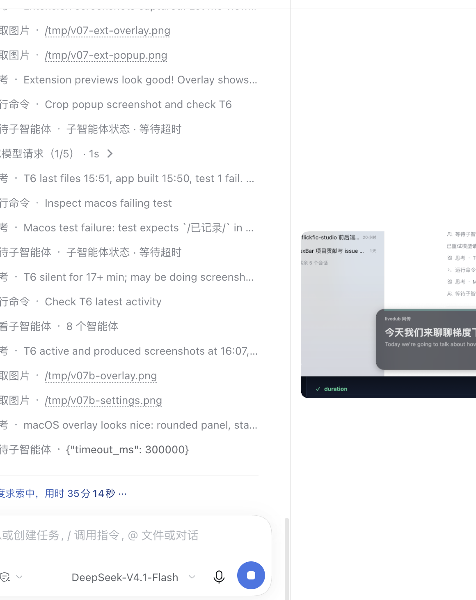
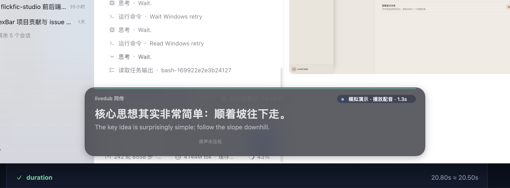

# livedub macOS 菜单栏 App（ScreenCaptureKit 系统音频）

浏览器之外的「同传耳机」：**抓取系统 / 任意 App 的音频**（Zoom、腾讯会议、本地播放器、浏览器……）
→ 发送给本机 livedub 引擎 → 桌面**置顶双语字幕浮层 + 中文配音**。

- **v0.4 新能力**：全局快捷键 **⌥N**「边看边实现」——把当前双语字幕 + 时间戳 +（可选）屏幕截图
  一键记进本地引擎的学习笔记（`POST /api/notes/quick`），失败自动离线排队、引擎恢复后补发。
- **v0.5 新能力**：⌥N 笔记加入**画面文字（OCR）**——截图上传后调用引擎 `/api/vision/ocr`，
  把幻灯片/代码/字幕里的文字写进笔记；可选 **画面理解（VLM，默认关，慢约 20–30s）**。
  视觉不可用（旧引擎 / 未安装 vision 模块）时静默降级，笔记照常保存。
- **v0.6 新能力**：可选**实时画面上下文**——直播时每 10s 截屏 OCR，经 WS `visual-context`
  推给引擎作为实时翻译参考（默认**关闭**，注意 CPU/耗电与画面隐私；异步、不阻塞音频/字幕）。
- **v0.7 新能力**：**视觉重设计**——jade/ink 色板、材质模糊浮层（降低透明度自动降级纯色）、
  品牌小标 + 状态 pill、22–26pt 译文层级、accent 呼吸线、悬停工具条、亮暗自适应、150–200ms 动效
  （`reduceMotion` 关闭）；新增**设置窗口**（字号/宽度/位置/透明度/穿透/音频/笔记与视觉/引擎只读，
  即时生效 + 恢复默认 + Esc 关闭）；**菜单栏分区重构**（SF Symbol 图标 + 快捷键提示 + 状态摘要）；
  VoiceOver label / 28pt 命中区 / focus ring。见 [设计说明](https://github.com/LeoLin990405/livedub/blob/main/docs/DESIGN.md)。
- 和 Chrome 扩展（只抓网页标签页）、本地工作台（只处理本地文件）互补，三端共用同一套线协议：
  [`docs/CONTRACTS.md`](../../docs/CONTRACTS.md) §3 / [`engine/protocol.mjs`](../../engine/protocol.mjs)。
- 原生 Swift，零第三方依赖：只用系统框架 `ScreenCaptureKit` / `AVFoundation` / `AppKit` / `Foundation`。
- 扫描线：`SCShareableContent` → `SCStream(capturesAudio=true)` → CMSampleBuffer → **16k mono s16le / 100ms 帧** → 本地引擎 WS。
- 引擎返回 `partial/segment/translation/dub/metrics/status/voice/error` → 浮层字幕 + `AVAudioEngine` 配音。

## 目录结构

```text
apps/macos/
├── Sources/
│   ├── main.swift                 # 入口：参数解析、NSApplication、菜单栏、会话编排、--simulate、⌥N 笔记
│   ├── ScreenAudioCapture.swift   # ScreenCaptureKit 只抓音频：CMSampleBuffer -> mono float -> 16k s16le -> 100ms 分帧
│   ├── EngineClient.swift         # URLSessionWebSocketTask：hello / 二进制帧 / 事件解析 / 指数退避重连 / ping
│   ├── OverlayWindow.swift        # v0.7 NSPanel 浮层：材质模糊/品牌+状态 pill/层级字幕/呼吸线/悬停工具条
│   ├── DubPlayer.swift            # AVAudioEngine + AVAudioPlayerNode：24k PCM 按 startMs 排序播放
│   ├── Settings.swift             # UserDefaults：引擎地址 / 字号 / 浮层位置 / 点击穿透 / 配音 / 笔记开关
│   ├── Protocol.swift             # 线协议 Swift 镜像（帧编解码、hello、事件解析、字幕折行、重采样）
│   ├── NotesClient.swift          # Notes API 客户端 + 离线队列（≤50 条）+ 笔记文本/视频标题纯函数
│   ├── Screenshot.swift           # SCScreenshotManager 截图（PNG ≤4MB）+ 截图降级决策
│   ├── Vision.swift               # v0.5 视觉纯逻辑：OCR/analyze 请求、文本清洗/代码块转义、降级决策、health 解析
│   ├── VisualContext.swift        # v0.6 实时画面上下文：visual-context 事件、清洗/去重/发送决策/状态文案
│   ├── OverlayDesign.swift        # v0.7 设计 token / 布局纯函数 / 状态 pill / toast / 菜单文案 / a11y / 亮暗降级
│   ├── SettingsWindow.swift       # v0.7 设置窗口：分组表单 + 即时生效 + 恢复默认 + Esc 关闭
│   ├── HotKey.swift               # Carbon RegisterEventHotKey 全局 ⌥N（无第三方依赖）
│   └── SelfTest.swift             # --self-test headless 自检 + --simulate 演示语料
├── Info.plist                     # LSUIElement=true（菜单栏 App）、NSScreenCaptureUsageDescription 等
├── README.md                      # 本文件
└── build/                         # 构建产物（.gitignore 已忽略）
scripts/build-macos.sh             # 构建脚本（swiftc -O -> livedub.app，--check 跑自检）
tests/macos.test.mjs               # 静态契约测试（CI 跨平台，不依赖 swiftc）
```

## 环境要求

| 依赖 | 要求 | 说明 |
|---|---|---|
| macOS | **14+**（Sonoma 及以上） | ScreenCaptureKit 音频捕获 API |
| Swift | `/usr/bin/swiftc`（Swift 5.10 实测） | 只需 Command Line Tools：`xcode-select --install`；**不需要完整 Xcode** |
| 引擎 | Node ≥ 22 + 本地 livedub 引擎 | 同仓库 `node engine/server.mjs`（默认 `ws://127.0.0.1:8787/ws`） |
| 第三方依赖 | **零** | 不使用 SPM / CocoaPods / xcodebuild 工程 / npm 包 |

## 构建

```bash
cd livedub

# 构建 .app（默认）
bash scripts/build-macos.sh
#   -> apps/macos/build/livedub.app
#      Contents/MacOS/livedub
#      Contents/Info.plist
#      Contents/PkgInfo

# 编译 + headless 自检（提交前 / CI 用；失败退出码 1）
bash scripts/build-macos.sh --check

# 清理构建产物
bash scripts/build-macos.sh --clean
```

- 可覆盖环境变量：`SWIFTC=/path/to/swiftc`、`MACOS_TARGET=arm64-apple-macos14.0`。
- 脚本只显式链接系统框架：`AppKit` / `AVFoundation` / `CoreMedia` / `CoreGraphics` / `ScreenCaptureKit`。
- 构建末尾会做 **ad-hoc 签名**（`codesign --force --sign -`），便于 `open` 正常启动；App 未公证。
- 本机实测（Swift 5.10 / macOS 14.8.9，Apple Silicon）：增量编译约 **6–15s**（clean 全量约 36s）、
  可执行文件 **1,002 KB**、bundle **1.0 MB**（v0.7 视觉重设计 + 设置窗口）。

## 运行

### 1. 启动 App（会一起打开本机引擎）

直接打开 App 即可。本机 `127.0.0.1:8787` 上如果还没有 livedub 引擎，App 会自己拉起仓库里的 `node engine/server.mjs`（安装在 `/Applications` 时找 `~/livedub`，从仓库里的构建产物启动时找上层目录）。引擎已经在跑就复用，退出 App 只关掉自己拉起的那一个。

仍可手动先开引擎，App 发现健康检查通过后不会再开第二个：

```bash
node engine/server.mjs          # 或 npm start / npm run studio
# 健康检查：curl http://127.0.0.1:8787/health
```

### 2. 启动 App

```bash
open apps/macos/build/livedub.app
```

菜单栏出现字幕气泡图标（**没有 Dock 图标**，这是菜单栏 App 的预期形态）。
点菜单栏图标 → **开始同传** → 首次会提示授予「屏幕录制」权限。

### 3. 直接运行二进制（调试 / 冒烟）

```bash
BIN=apps/macos/build/livedub.app/Contents/MacOS/livedub

"$BIN" --self-test                 # headless 自检，退出码 0/1（不建窗口、不请求权限）
"$BIN" --simulate --duration 10    # 无权限/无引擎演示 UI（自动退出便于冒烟）
"$BIN" --autostart --duration 15   # 自动开始同传，15s 后自动退出
"$BIN" --autostart --note-once --duration 10   # 自动开始 + 2.5s 后记一条测试笔记（截图/OCR/队列全链路）
"$BIN" --autostart --note-once --notes-vision --duration 20   # 冒烟 VLM（慢）路径
"$BIN" --engine-url ws://127.0.0.1:8787/ws --autostart
"$BIN" --help
```

| 参数 | 说明 |
|---|---|
| `--simulate` | 不抓音频、不连引擎，循环演示中英字幕/状态/延迟（无权限环境验证 UI） |
| `--autostart` | 启动后自动点一次「开始同传」（适合登录项 / 自动化冒烟） |
| `--note-once` | 启动 2.5s 后自动记一条测试笔记（截图/OCR/VLM 全链路）；未显式给 `--duration` 时记录完自动退出（冒烟用） |
| `--notes-vision` | 调试用：本次运行开启「画面理解（VLM，慢）」开关（不写用户设置） |
| `--visual-context` | 调试用：本次运行开启「实时画面上下文（OCR，每 10s 推送）」开关（不写用户设置） |
| `--show-settings` | 调试/截图用：启动后直接打开设置窗口 |
| `--demo-toast` | 调试/截图用：启动 2.2s 后演示一条「已记录笔记」toast |
| `--duration <秒>` | N 秒后自动退出（调试用） |
| `--engine-url <url>` | 覆盖引擎地址并持久化 |
| `--self-test` | headless 自检：协议字节布局 / hello / 事件解析 / 字幕排版 / 重采样 / 分帧 |
| `-h, --help` | 帮助 |

### 菜单栏功能

| 菜单项 | 行为 |
|---|---|
| 状态摘要 | 只读：连接状态 · 当前状态 · 延迟 · OCR/VLM · 画面上下文（引擎地址在下一行） |
| 开始 / 停止同传 | 连接引擎 + 开始系统音频捕获；再次点击停止 |
| 暂停 / 继续同传 | 直播中暂停/恢复引擎处理（浮层工具条同功能） |
| 记笔记（⌥N） | 把当前双语字幕 + 时间戳（+ 可选截图/OCR）记进学习笔记；全局快捷键 ⌥N |
| 设置…（⌘,） | 打开设置窗口（字号/宽度/位置/透明度/穿透/音频/笔记与视觉/引擎只读） |
| 打开笔记 / 打开工作台 | 打开工作台学习笔记面板（`/studio/?notes=1`）/ 工作台首页 |
| 显示 / 隐藏字幕浮层 | 浮层显隐 |
| 退出 livedub（⌘Q） | 停止采集与播放后退出 |
| 视觉：… | 只读：OCR/VLM 是否可用（来自 `/api/vision/health`） |

> 点击穿透、字幕显示模式、字号、透明度、记笔记附截图 / OCR / VLM / 画面上下文等开关已统一移入
> **设置窗口**（菜单「设置…」或 ⌘,）。

浮层（v0.7）：品牌小标 + 状态 pill（圆点/状态/延迟/连接）+ 译文 22–26pt semibold + 原文 13–14pt 次级；
无边框、20pt 圆角、材质模糊（系统降低透明度时降级纯色）、顶部 accent 呼吸线、柔和阴影、亮暗自适应；
`NSPanel(.nonactivatingPanel)` 不抢焦点；**整个浮层可拖动**、位置持久化、多桌面/全屏 App 上可见；
鼠标悬停显示微型工具条（暂停 / 记笔记 / 设置 / 关闭，28pt 命中区），点击穿透开启时不响应鼠标。

## 权限设置（第一次必做）

macOS 用**「屏幕录制」权限**管控系统音频捕获——系统弹窗文案是「录制屏幕」。默认情况下
**livedub 只读取音频流，不截屏、不保存画面**；只有你开启「记笔记时附截图」并按 ⌥N 时，
才会截取当前屏幕作为该条笔记的本地附件（同一 TCC 权限，不需要额外授权）。

1. 菜单栏 livedub → 开始同传；
2. 系统弹窗 / 或菜单「打开屏幕录制权限设置…」→
   **系统设置 → 隐私与安全性 → 屏幕录制** → 勾选 **livedub**；
   （从终端直接运行二进制时，勾选的是启动它的**终端 App**）；
3. 回到 App。若系统要求重启 App，退出再 `open` 一次；App 会每秒轮询权限，授权后自动开始捕获。

实现：`CGPreflightScreenCaptureAccess()` 查询 + `CGRequestScreenCaptureAccess()` 触发系统弹窗；
截图复用同一权限（`SCScreenshotManager`），失败自动降级纯文字笔记。
注意：**重新构建后 ad-hoc 签名 cdhash 变化，屏幕录制权限可能需要重新勾选**（开发期正常现象）。

## 与引擎配合（协议细节）

- 地址：默认 `ws://127.0.0.1:8787/ws`；菜单可改，格式 `ws(s)://host:port/ws`
  （缺 scheme 补 `ws://`、缺端口补 `8787`、缺路径补 `/ws`）。
- `hello`（第一条，JSON 文本帧）：

  ```json
  {"type":"hello","protocol":1,
   "session":{"source":"macos","title":"macOS 系统音频 · livedub app",
              "url":"","langFrom":"en","langTo":"zh","tMsBase":null,"overrides":{}}}
  ```

  `source` 枚举已是 `extension|studio|batch|test|macos`（v0.3 收尾时加入），桌面端用 `macos`。
- 音频（二进制帧，与 `engine/protocol.mjs#encodeAudioFrame` **字节级一致**）：

  ```text
  [0]=0x01 | [1..8]=float64 big-endian tMs | [9..]=s16le 16k mono
  每 100ms 一帧（1600 采样 / 3200 字节 PCM；单帧上限 256KB）
  ```

  采集侧：ScreenCaptureKit 给 48kHz / 2ch / Float32（non-interleaved 或 interleaved）→
  混单声道 → 盒式抗混叠 + 线性插值重采样到 16k → 100ms 分帧。`tMs` 从 0 开始按帧递增。
- 下行事件处理：

  | 事件 | App 行为 |
  |---|---|
  | `ready` | 状态「聆听中」，记录 provider/音色 |
  | `status` | 浮层状态行 / 菜单状态（listening/translating/speaking/paused/error） |
  | `partial` / `segment` | 更新原文行 |
  | `translation` | 更新译文行（流式覆盖） |
  | `dub` | base64 s16le（默认 24kHz）→ `DubPlayer`：按 `startMs` 排序，到点播放；落后 >1.5s 丢弃 |
  | `metrics` | `e2eLagMs` 显示为「延迟 x.xs」 |
  | `voice` | 音色切换/降级提示 |
  | `error` | 状态标红；不可恢复错误弹窗 |
  | `pong` / `bye` | 保活 / 引擎关闭会话 |

- 断线：指数退避重连 **0.5s → 1s → 2s → 4s → 8s**（+0~0.25s 抖动），连接成功后计数归零；
  每次重连重新发 `hello`（新会话）。断线期间音频帧直接丢弃（不排队，避免补发造成延迟堆积）。
- `ping`：连接后每 15s 发 `{"type":"ping","t":...}` + WebSocket 协议级 ping。
- `pause/resume` control 消息已在 `EngineClient.sendControl(_:)` 封装（菜单暂未暴露）。

## 边看边实现：⌥N 全局快捷笔记（v0.4）

典型场景：一边听 Zoom / 网课 / 播放器（livedub 浮层显示双语字幕），一边在 **VSCode / IDE 里写代码**，
听到关键点按 **⌥N**，当前这句双语字幕 + 会话时间戳（+ 可选截图）就会记进本地学习笔记库；
之后在菜单「打开笔记」的 `/studio/?notes=1` 面板里复习 / 编辑 / 导出。

```text
系统音频 -> 引擎（字幕/翻译） -> 浮层双语字幕
                                   │  按 ⌥N（全局，任何 App 前台都生效）
                                   ▼
                    NoteComposer（原文/译文/时间/状态/前台 App/截图链接）
                                   │
             ┌─────────────────────┴──────────────────────┐
             ▼                                            ▼
  截图 PNG → POST /api/notes/assets               引擎未启动 / 请求失败
             │                                     UserDefaults 离线队列（≤50 条）
             ▼                                      引擎重连 / 每 60s 自动补发
  v0.5：POST /api/vision/ocr（8s 超时，默认开）
        POST /api/vision/analyze?mode=both（VLM，默认关，慢 20–30s）
             │  失败静默降级（不影响笔记保存）
             ▼
  POST /api/notes/quick 成功
  toast「已记录笔记 · HH:MM:SS」
```

- 全局热键：**Carbon `RegisterEventHotKey`**（系统自带，不需要「辅助功能 / 输入监控」授权，
  也不依赖第三方库）。若组合被其它 App 占用，日志会提示，菜单「记笔记（⌥N）」仍可用。
- 记录内容（`POST /api/notes/quick`，与 T4 Notes API 契约一致）：
  - `video`：`{id, title}`。id 优先用「媒体类前台 App（Zoom/播放器/浏览器）」→ `macos-zoom-us`，
    否则用引擎会话 id → `macos-s-xxxx`，再兜底 `macos-live`；标题同理推导（不满足则用会话标题/日期）。
  - `tMs`：会话时间轴毫秒（取最近一帧音频的时间，暂停时仍是最后一次音频位置）。
  - `text`：Markdown 片段，含 `**视频**`、`**原文**`、`**译文**`、`**记录**（会话时间/状态/延迟/前台 App）、
    `**来源**`（时间戳）、截图 Markdown 链接；无字幕时写 `（无字幕）`。
  - `quotes`：`[{t0Ms, src, dst}]` 双语引用；`source: "macos"`；
  - 字段与校验与 T4 `engine/server.mjs` 的 quick 白名单完全一致（未知字段会被 400，本客户端严格发送契约内字段）。
  - 截图：先 `POST /api/notes/assets`（raw PNG，≤4MB，content-type `image/png`）拿 `{ok,url}`；
    **text 里用绝对 URL 写 Markdown 图片**（便于渲染），**quick 的 `imageUrl` 字段按服务端契约用
    相对路径** `/api/notes/assets/<file>.png`（T4 会校验，绝对 URL 会 400）；若旧版引擎仍拒绝
    `imageUrl`，自动去掉该字段重试（截图链接仍在 text 里，不丢笔记）。
- 截图（默认开，菜单可关）：`SCScreenshotManager.captureImage`（macOS 14+）抓当前显示器，
  **复用屏幕录制权限**（与音频捕获同一个 TCC 授权），并**排除 livedub 自己的浮层/窗口**；
  PNG > 4MB 时自动降采样（1.0 → 0.75 → 0.55 → 0.4），仍超限或截图失败 → **降级为纯文字笔记**（日志说明原因）。
- 离线队列：引擎没启动 / Notes API 404 / 网络失败 → 笔记进 `UserDefaults` 队列（最多 50 条，丢最旧）；
  WS 重连成功或每 60s 自动 flush，逐条补发；菜单「笔记队列：N 条待同步」可见。
- 浮层 toast：成功「已记录笔记 · 14:20:33」；离线「引擎未连接，笔记已排队 · 14:20:33」；
  VLM 开启时先提示「画面理解中…（VLM 约 20–30s）」。
- 权限：无需新增权限——截图复用「屏幕录制」；OCR 用引擎侧本地 macOS Vision；不开启附截图时，笔记只含文本（没有画面可识别）。

### 画面文字（OCR）/ 画面理解（VLM）（v0.5）

`⌥N` -> 截图上传 assets 成功后，按设置调用引擎视觉端点，把结果写进 quick note 的 `text`：

- **画面文字（OCR，默认开）**：`POST /api/vision/ocr`，body `{"imageUrl":"/api/notes/assets/<file>.png"}`，
  **8s 超时**；返回 `{ok,text,lines,provider,ms}`。清洗规则：按行 trim/去空行、相邻重复行去重、
  去控制字符、最多 80 行 / 2000 字（超出加 `…`）；用 Markdown 代码块写入（内容含反引号时自动用更长 fence）：

  ````markdown
  **画面文字**（OCR）：

  ```
  Gradient descent
  Follow the slope downhill
  ```
  ````

  没有可读文字时**不加**该段；OCR 失败只写日志、笔记照常保存。
- **画面理解（VLM，默认关）**：`POST /api/vision/analyze?mode=both`（**45s 客户端超时**；服务端慢操作
  默认 90s 上限），返回 `{ok,ocr?,caption?}`；caption 写入 `**画面理解**：` 段落，OCR 若还没拿到会用
  analyze 的 `ocr` 兜底。开启时浮层先提示等待；超时/未配置/失败 -> **降级为仅 OCR**（不丢笔记）。
- **视觉能力状态**：启动、引擎连上、每 5 分钟、切换开关时 `GET /api/vision/health`，菜单「视觉：…」显示
  `OCR 可用/不可用 · VLM 已配置/未配置`。旧引擎（v0.4 无 `/api/vision/*`）返回 404 -> 菜单显示
  「不可用（引擎 < v0.5）」，整个运行期跳过视觉调用，**笔记照常保存（字幕+截图）**。
- **延迟/费用**：OCR 本地 macOS Vision，通常 <1s、无云端费用；VLM 取决于引擎配置（可能调用云端 ark-plan），
  单次约 20–30s，**可能产生费用**，所以默认关。笔记保存只等 OCR（快）；开 VLM 时才会等慢路径。
- **隐私**：截图只作为本地笔记附件存 `data/notes/assets/`；开启 VLM 时截图会按引擎配置发给 VLM provider
  （可能是云端）。介意隐私请保持 VLM 关闭（OCR 仍是本地的）。

### 手动验证 ⌥N（不依赖真实引擎）

```bash
# 假引擎（HTTP Notes API + WS ready/字幕事件，只在本机 18788 端口，不联网）
node /tmp/mock-notes-engine.mjs        # 脚本样例见验收记录；或直接连真实引擎
BIN=apps/macos/build/livedub.app/Contents/MacOS/livedub

# A. 引擎在线：自动开始同传 -> 2.5s 后记一条（含截图上传）-> 日志出现 sent
"$BIN" --engine-url ws://127.0.0.1:18788/ws --autostart --note-once --duration 10

# B. 引擎离线再恢复：先离线排队，再启动引擎 -> 自动补发
"$BIN" --engine-url ws://127.0.0.1:18788/ws --autostart --note-once --duration 25 &
sleep 6 && node /tmp/mock-notes-engine.mjs
```

真实使用：引擎跑着并播放任意英文音源 → 打开 VSCode → 需要记录时按 **⌥N**（任何 App 在前台都生效；
系统设置里不需要给 livedub 辅助功能权限）。若没反应：先用菜单「记笔记」确认链路，再检查日志中的
「全局快捷键 ⌥N 已就绪 / 注册失败」。

## 可选：实时画面上下文（供翻译参考，v0.6）

同传时除了声音，画面里的文字（PPT/代码/板书/会议共享屏）也能帮助翻译更准确。开启后 App 会**每 10 秒**
截取一次屏幕 → OCR → 把画面文字通过 WS 文本帧推给引擎，引擎把它作为最近 120s 的翻译参考上下文。

```text
每 10s（可配 8–15s）：
  SCScreenshotManager 截屏（排除 livedub 自身浮层）
    -> POST /api/notes/assets（PNG 存本地笔记资产）
    -> POST /api/vision/ocr（本地 OCR）
    -> 清洗/去重/截断 2000 字
    -> WS 文本帧 {"type":"visual-context","text":"…","tMs":…,"source":"macos","capturedAtMs":…}
       （引擎 TTL 120s；同内容重复忽略；断开不排队）
```

- **默认关闭**：每 10s 一次截屏 + OCR + 上传会带来额外 CPU/耗电，且画面内容涉及隐私，所以默认不推送。
  菜单「翻译参考画面文字（OCR，每 10s）」随时开关；关闭时立即停止并清空状态。
- **只在直播 + 已连接会话时推送**：同传暂停（引擎 status=paused）、停止、引擎断线/重连期间都不推送，
  也不排队补发（画面上下文过期无意义）；会话就绪时先推一次，之后按间隔推送。
- **去重**：同一画面 OCR 文本（归一化空白/大小写后）与上次相同则跳过，不浪费 WS 与引擎处理。
- **不阻塞主链路**：截图/上传/OCR 全部后台异步，音频帧与字幕事件不受影响；失败只记一行日志，下一轮继续
  （例如 OCR 服务暂不可用、屏幕录制权限被撤销、引擎断线）。
- **状态展示**：菜单「画面上下文：开 · 最近 15:23:45 · 上次 OCR 128 字」；开启后首次推送成功会在浮层
  顶部弹一次 toast「画面上下文：已开始推送 · N 字 · HH:MM:SS」；诊断信息里也有最近状态/错误。
- **间隔可配**（8–15s，默认 10s，命令行设置后重启 App 生效）：

  ```bash
  defaults write io.github.leolin990405.livedub.macos livedub.macos.visualContextInterval -float 12
  defaults delete io.github.leolin990405.livedub.macos livedub.macos.visualContextInterval  # 恢复默认 10s
  ```

- **隐私与费用**：截图只上传给**本机引擎**，OCR 在本地（macOS Vision）；但识别出的**画面文字会作为翻译
  上下文发给翻译 provider（如 deepseek，云端）**——屏幕上有敏感信息（密码/聊天/合同）时请不要开启。
  资产文件会落在引擎的 `data/notes/assets/`（可定期清理）。
- **权限**：复用「屏幕录制」权限（与音频捕获/⌥N 截图同一 TCC 授权，无需额外授权）。

## v0.7 视觉重设计 / 设置窗口 / 菜单 / 可访问性

按统一设计语言 [`docs/DESIGN.md`](../../docs/DESIGN.md)（jade/ink 色板、内容优先、短动效、可访问）重做桌面端 UI，
不改变音频/字幕/笔记/画面上下文的任何主链路行为。

### 浮层

- **层级**：品牌小标 `livedub 同传` → 状态 pill（语义色圆点 + 状态 + 延迟 + 连接状态）→ 译文（22–26pt semibold，
  `text-strong`）→ 原文（13–14pt，次级）→ accent 呼吸线 + 悬停工具条；说话/播放配音时显示「原声未压低」提示。
- **材质**：`NSVisualEffectView(.hudWindow / behindWindow)` + 半透明 tint；系统「降低透明度」时自动降级纯色不透明；
  亮暗外观自适应（语义色），20pt 圆角 + 柔和阴影。
- **动效**：字幕淡入 180ms、工具条 160ms、toast 180ms；顶部 accent 线 2.4s 呼吸；系统「减少动态」时全部静止。
- **交互**：整层拖动、点击穿透（设置项）、位置记忆/底部居中/顶部居中；悬停 0.6s 后隐藏工具条
  （暂停/记笔记/设置/关闭，均为 28pt 命中区 + VoiceOver label）。
- **toast**：图标 + 单行文案 + 语义色（成功 jade / 排队 amber / 失败 rose），3s 自动消失；
  ⌥N 记笔记、画面上下文开始推送等反馈走同一组件。

### 设置窗口（新增）

菜单「设置…（⌘,）」打开独立 `NSWindow`（Esc 关闭），全部改动**即时生效并持久化**：

| 分组 | 设置项 |
|---|---|
| 字幕 | 字号 22–26pt 滑杆；显示模式：双语 / 仅译文 / 仅原文 |
| 浮层 | 宽度（自动随字号 / 480–1100pt）、位置（底部居中 / 顶部居中 / 记住上次）、不透明度 55%–100%、点击穿透 |
| 音频 | 播放中文配音（并说明系统原声不会被自动压低） |
| 笔记与视觉 | 记笔记附截图、OCR、VLM（慢 20–30s）、画面上下文（每 10s 推送） |
| 引擎 | 引擎地址**只读**展示；屏幕录制权限设置、诊断信息入口 |
| 底部 | 恢复默认（仅重置呈现相关项）、关闭 |



### 菜单栏

分区：**状态摘要**（引擎 · 当前状态 · 延迟 · OCR/VLM · 画面上下文）→ **开始/停止、暂停/继续、记笔记 ⌥N**
→ **设置… ⌘, / 打开笔记 / 打开工作台** → **显示/隐藏浮层 / 退出 ⌘Q**。
全部使用 SF Symbol 图标并显示快捷键提示；状态摘要随引擎/延迟/视觉能力实时更新。

### 可访问性

- 悬停工具条与设置窗口所有控件均设置 VoiceOver label / tooltip；状态 pill 以「状态 + 延迟」文字读屏，
  不只靠颜色（圆点 + 文字双表达）。
- 命中区 ≥28pt（工具条按钮 28×28）；设置窗口按钮/滑杆为标准 macOS 控件，focus ring 可见，Esc 关闭。
- `accessibilityDisplayShouldReduceMotion` → 关闭呼吸/淡入/工具条动画；
  `accessibilityDisplayShouldReduceTransparency` → 浮层材质降级为纯色保证对比度。
- 亮/暗外观使用语义色（`labelColor` / `secondaryLabelColor` / 系统 accent 语义），高对比模式下可读。

### 截图（`--simulate` + screencapture）

| 浮层（双语 / 状态 pill / 原文 / duck 提示） | 浮层 + toast | 设置窗口 |
|---|---|---|
|  |  |  |

复现命令：

```bash
BIN=apps/macos/build/livedub.app/Contents/MacOS/livedub
"$BIN" --simulate --demo-toast --duration 10 &   # 浮层 + toast
"$BIN" --show-settings --duration 8 &            # 设置窗口
```

## 自检 / 测试

```bash
# 1) 编译 + 自检（273 项，退出码 0/1）
bash scripts/build-macos.sh --check

# 2) 静态契约测试（默认跨平台、离线、不跑 swiftc —— CI 在 ubuntu 也能跑）
node --test tests/macos.test.mjs

# 3) 本机完整构建测试（macOS）
LIVEDUB_MACOS_BUILD=1 node --test tests/macos.test.mjs
```

`--self-test` 覆盖（headless，不建窗口 / 不请求权限 / 不联网）：

- 协议常量与 `engine/protocol.mjs` 对齐：`0x01` / `16000` / `100ms` / `256KB` / `24000` / `ws://127.0.0.1:8787/ws`；
- 音频帧字节布局：长度 9+3200、`tMs=1234` 的 IEEE‑754 固定字节向量 `40 93 48 00 00 00 00 00`、
  s16le 小端字节、往返解码、空 PCM / 负 tMs / 超限 / 错误魔数拒绝；
- `hello` JSON 字段（type/protocol/session/source 枚举/tMsBase=null/中文标题）与非法 source 回落；
- 事件解析：`ready/status/partial/segment/translation/dub(base64)/metrics/voice/error/pong/bye/unknown`；
- 字幕折行（ASCII / CJK 双列宽 / 超长 token 硬切 / 最多 2 行省略）、延迟格式（`1.8s` / `—`）、状态文案；
- 16k 100ms 分帧（不足不出帧、tMs 递增、reset）、48k/44.1k → 16k 重采样（长度 / RMS / 静音）；
- 引擎地址清洗（补 scheme/端口/`/ws`、http→ws、非法回落默认）；
- **v0.4 笔记**：Notes HTTP 基址换算（ws→http/wss→https）、`/studio/?notes=1` URL、assets 相对/绝对 URL；
  会话时间格式（`01:23.4` / `1:02:03.4`）、墙钟 `HH:MM:SS`、日期；视频标题/ID 推导（媒体 App / 会话 / 兜底 /
  清洗 / slug）；quick note 文本（原文/译文/时间/来源/截图 markdown/无字幕）与 JSON 字段编解码往返；
  离线队列（≤50 丢最旧、FIFO、enqueueFront、clear、损坏数据安全丢弃、注入内存存储不写用户偏好）；
  截图降级决策（关闭/无权限/失败/超 4MB/正常）与降采样序列；⌥N 热键常量（`kVK_ANSI_N=45`、Carbon optionKey）；
- **v0.5 画面文字/画面理解**：OCR/analyze 请求体 JSON、`/api/vision/*` URL 与 `mode` 归一化、imageUrl 相对路径校验；
  OCR 文本清洗（trim/去空行/去重/去控制字符/80 行/2000 字截断）、代码块反引号转义、`**画面文字**（OCR）`/
  `**画面理解**` 段落格式；降级决策（关闭/无截图/旧引擎 404/服务未就绪 503/health 未配置）、健康 JSON 解析
  （bool 与对象两种能力形态）、analyze 响应 string/object 兼容、图文笔记正文顺序与 4000 字上限；
- **v0.6 实时画面上下文**：`visual-context` 事件字段/JSON 契约（恰好 5 字段、source=macos、capturedAtMs 墙钟毫秒）、
  OCR 文本清洗/截断 2000 字、同帧去重（相同/空白大小写差异/不同/首次）、发送决策（默认关闭/未连接/暂停/停止/无会话
  均跳过，直播+已连接才 push）、间隔 8–15s 钳制、菜单状态文案与契约常量（TTL 120s）。

## 手动测试清单

> 前置：`bash scripts/build-macos.sh --check` 通过；`node engine/server.mjs` 已启动（除模拟模式）。

- [ ] `--self-test` 退出码 0，输出 `self-test: N checks passed`
- [ ] **模拟模式**：`"$BIN" --simulate --duration 12` → 浮层出现，中文大字 + 英文小字 + 状态 + 延迟轮换；
      菜单「停止模拟演示」可用
- [ ] **引擎未启动**：先不启动引擎，开始同传 → 状态「重连引擎…」，日志出现指数退避；
      启动引擎后 8s 内自动连上（无需重启 App）
- [ ] **真实音频**：播放一段英文播客/视频/Zoom 会议（系统声音）→ 原文行先出、译文随后出现，
      延迟数字约 2–4s（取决于引擎 provider 配置）
- [ ] **配音**：默认开启能听到中文配音；菜单关闭后立即静音（原声继续）
- [ ] **浮层交互**：拖动位置 → 退出重开位置保持；开启点击穿透 → 可点击下层窗口且无法拖动；
      关闭后可拖动；「重置字幕位置」回到底部居中
- [ ] **v0.7 浮层外观**：品牌小标 + 状态 pill（圆点颜色随状态）+ 24pt 译文 + 14pt 原文 + 顶部 accent 呼吸线；
      亮色/暗色外观切换后文字与材质均清晰；系统「降低透明度」时变为纯色；「减少动态」时无呼吸/淡入动画
- [ ] **悬停工具条**：鼠标移到浮层 → 右下角出现暂停/记笔记/设置/关闭按钮（28pt 命中区，hover 高亮）；
      点暂停后引擎暂停、按钮变继续；点关闭隐藏浮层；开启点击穿透时工具条不响应
- [ ] **v0.7 设置窗口**：菜单「设置…」或 ⌘, 打开；拖动字号/宽度/不透明度即时生效；
      切换显示模式（双语/仅译文/仅原文）即时变化；点击穿透、附截图、OCR、VLM、画面上下文开关生效；
      引擎地址只读；「恢复默认」恢复字号/宽度/透明度/模式；Esc 关闭
- [ ] **v0.7 菜单栏**：状态摘要显示 引擎/状态/延迟/OCR/画面上下文；开始/停止、暂停/继续、记笔记 ⌥N、
      设置 ⌘,、打开笔记/工作台、退出 ⌘Q 均有图标与快捷键提示
- [ ] **字号**：增大/减小即时生效，重启后保持
- [ ] **权限**：系统设置取消勾选 livedub → 开始同传 → 出现权限提示；重新授权后自动恢复捕获
- [ ] **断线重连**：`kill` 引擎 → 状态重连；重启引擎 → 自动恢复（不重启 App）
- [ ] **⌥N 记笔记（真实链路）**：同传中按 ⌥N → 浮层顶部 toast「已记录笔记 · HH:MM:SS」；
      引擎 `data/notes/quick-YYYY-MM-DD.md` 里出现原文/译文/时间戳（菜单「打开笔记」可见）
- [ ] **⌥N 在其它 App 前台**：切到 VSCode / 浏览器后再按 ⌥N 仍能记录（全局热键；不需要辅助功能授权）
- [ ] **附截图开关**：菜单关闭「记笔记时附截图」→ 再按 ⌥N，笔记无截图（纯文字）；开启后恢复，
      截图不含 livedub 浮层，PNG 附件出现在笔记里（服务端 assets）
- [ ] **离线队列**：先停掉引擎 → 按 ⌥N → toast「引擎未连接，笔记已排队」、菜单「笔记队列：1 条待同步」；
      启动引擎后 60s 内（或重连后立即）自动补发，队列清零
- [ ] **暂停时仍可笔记**：暂停同传（或关闭该开关）验证：开=可记录最后一句；关=toast 提示被禁用
- [ ] **画面文字 OCR**：播放带幻灯片的英文课/代码画面 → ⌥N → 笔记正文出现
      `**画面文字**（OCR）` 代码块（引擎 v0.5 + vision 模块就绪时）；无文字画面则不出现该段
- [ ] **OCR 关闭开关**：菜单关闭「识别画面文字（OCR）」→ 再按 ⌥N，笔记只有字幕+截图；重新打开恢复
- [ ] **画面理解 VLM（可选）**：菜单开「画面理解（VLM）」→ ⌥N → 浮层提示「画面理解中…」→ 笔记出现
      `**画面理解**：` 段（未配置 VLM/超时则自动降级为仅 OCR）；之后关掉开关避免每次都慢 20–30s
- [ ] **实时画面上下文（默认关）**：菜单开启「翻译参考画面文字（OCR，每 10s）」→ 浮层 toast「已开始推送」；
      菜单状态变「画面上下文：开 · 最近 HH:MM:SS · 上次 OCR n 字」；引擎日志/事件里出现 `visual-context`
- [ ] **画面上下文去重**：画面 10s 不变时，App 日志出现「内容与上次相同，跳过」，不再重复发 WS
- [ ] **暂停/停止不推送**：暂停同传 → 定时器到点日志「跳过：同传已暂停」；停止后不再截屏/OCR；
      关闭开关后应立即停止并清空菜单状态
- [ ] **旧引擎降级**：引擎不升级（无 `/api/vision/*`）→ 菜单「视觉：不可用（引擎 < v0.5）」，
      ⌥N 笔记仍正常保存（字幕+截图，无 OCR 段），日志提示跳过
- [ ] **退出**：菜单退出后 `pgrep -fl livedub` 无残留；无 Dock 图标（菜单栏 App 正常形态）

### 验收记录（本机实测，2026-10-29，Swift 5.10 / macOS 14.8.9 / Apple Silicon）

- `bash scripts/build-macos.sh --check`：编译 6s，**self-test 76/76 通过**，退出码 0；
  可执行文件 403 KB，bundle 416 KB。
- `livedub --self-test` 直接运行退出码 0。
- **端到端**（用 `engine/ws.mjs` 起一个临时假引擎，端口 19787，不联网）：
  hello 字段正确；真实 SCK 采集到 48kHz/2ch/float32 系统音频；
  7.4s 内发出 **75 帧、每帧 PCM 3200 字节、tMs 0→7400 递增、坏帧 0**
  （用 `engine/protocol.mjs#decodeAudioFrame` 权威解析校验）。
- **重连**：假引擎每 2.5s 断开一次 → App 自动重连 3 次、每次重新 hello，期间音频帧持续发送。
- **模拟模式 UI**：真实创建菜单栏图标 + 置顶浮层，截图确认译文/原文/状态/延迟渲染正确。

### v0.4 验收记录（2026-10-30，Swift 5.10 / macOS 14.8.9 / Apple Silicon）

- `bash scripts/build-macos.sh --check`：**self-test 139/139 通过**，退出码 0，0 warning；
  可执行文件 653 KB，bundle 668 KB。
- **⌥N 端到端（假引擎 18788，HTTP + WS，全部本机）**：
  - App 日志：`全局快捷键 ⌥N 已就绪` → 自动开始同传 → 2.5s 后 `已记录（sent）· 截图 已上传 943KB` → exit 0；
  - 假引擎收到：`POST /api/notes/assets` → **PNG 966,515 字节、签名正确、content-type=image/png**；
    `POST /api/notes/quick` → `source=macos`、`tMs=2000`、`video={id:"macos-s-mock-1",title:"macOS 系统音频 · livedub app"}`、
    `text` 含 `**原文**/**译文**/**记录**（时间 00:02.0 · 状态 聆听中 · 延迟 1.8s · 前台 App）`、
    `quotes=[{t0Ms,src,dst}]`、`imageUrl` 为**相对路径** `/api/notes/assets/img_xxx.png`（严格契约校验 0 拒绝）；
  - 浮层 toast 截图确认「已记录笔记 · 14:25:13」渲染正确；
  - 截图附件实测 1440×900 PNG、1.13MB、仅当前屏幕内容——**不含 livedub 浮层/菜单栏图标**
    （`SCContentFilter` 排除自身进程 `SCRunningApplication`，人工查看产物确认）。
- **离线队列 → 重连补发**：引擎离线时按 ⌥N → `已离线排队（queued 1）`（截图上传失败自动降级纯文字）；
  6s 后启动引擎 → 应用指数退避重连成功 → `离线笔记补发完成：成功 1 条，剩余 0 条` → exit 0；
  假引擎收到 text 含 `（无字幕）`（离线时无引擎事件，符合预期）、无 imageUrl。
- 自动化：`node --test tests/macos.test.mjs` 全绿（含 v0.4 静态契约断言）。

### v0.5 验收记录（2026-10-30，Swift 5.10 / macOS 14.8.9 / Apple Silicon）

- `bash scripts/build-macos.sh --check`：**self-test 194/194 通过**，退出码 0，0 warning；
  可执行文件 788 KB，bundle 800 KB。
- **OCR 端到端**（严格契约假引擎 18788：Notes + Vision API，全部本机）：
  `--autostart --note-once`（OCR 默认开、VLM 默认关）→ 日志 `视觉：OCR mock-ocr · VLM mock-vlm` →
  截图 725KB 上传 → `POST /api/vision/ocr` body `{"imageUrl":"/api/notes/assets/img_xxx.png"}` →
  quick note text 含 `**画面文字**（OCR）` 代码块（`Gradient descent / Follow the slope downhill …`），
  无 `**画面理解**` 段；exit 0。
- **VLM 端到端**：`--notes-vision` → `POST /api/vision/analyze?mode=both` →
  笔记 text 同时含 OCR 代码块 + `**画面理解**：幻灯片在讲解梯度下降的几何直觉…`；日志 `VLM 已生成（31 字）`。
- **旧引擎 404 降级**：假引擎关闭 Vision（/api/vision/* 返回 404）→ 菜单/日志「视觉：不可用（引擎 < v0.5）」→
  ⌥N 笔记照常保存（字幕+截图，无 OCR），`画面 OCR 跳过：引擎无视觉端点（需 v0.5）`，exit 0。
- 自动化：`node --test tests/macos.test.mjs` 全绿（含 v0.5 静态契约断言）。

### v0.6 验收记录（2026-10-30，Swift 5.10 / macOS 14.8.9 / Apple Silicon）

- `bash scripts/build-macos.sh --check`：**self-test 228/228 通过**，退出码 0，0 warning；
  可执行文件 862 KB，bundle 876 KB。
- **实时画面上下文端到端**（严格契约假引擎 18788：Notes + Vision + WS 接收校验，全部本机）：
  `--autostart --visual-context --duration 25` → 会话就绪立即推送 1 条（41 字，`tMs=0`），
  10s 后同画面文本重复 → 客户端日志「内容与上次相同，跳过」（未发 WS），
  20s 后画面文字变化 → 推送第 2 条（50 字，`tMs=21000`）；
  假引擎校验两条事件字段全部合法（type/text 1..2000/source=macos/tMs≥0/capturedAtMs 为墙钟毫秒、
  **无非法事件**）；每条 685KB 截屏经 assets 上传 + `/api/vision/ocr` 后推送；
  App exit 0、主链路无阻塞；首次推送浮层 toast + 菜单状态 `画面上下文：开 · 最近 … · 上次 OCR 41 字`。
- 自动化：`node --test tests/macos.test.mjs` 全绿（含 v0.6 静态契约断言）。

### v0.7 验收记录（2026-10-30，Swift 5.10 / macOS 14.8.9 / Apple Silicon）

- `bash scripts/build-macos.sh --check`：**self-test 273/273 通过**，退出码 0，0 warning；
  可执行文件 1,002 KB，bundle 1.0 MB。
- 截图（`--simulate --demo-toast` / `--show-settings` + `screencapture`，见上方截图表）：
  `apps/macos/screenshots/overlay-bilingual.png`（双语 + 状态 pill + 原声提示）、
  `apps/macos/screenshots/overlay-toast.png`（成功 toast + 播放配音状态）、
  `apps/macos/screenshots/settings-window.png`（设置窗口全分组）。
- 视觉验证点：品牌/状态 pill 不截断（「模拟演示 · 播放配音 · 2.3s」）、译文 24pt 层级清晰、
  材质模糊 + 20pt 圆角 + accent 呼吸线可见、拖拽/点击穿透逻辑保留、
  VoiceOver label 与 28pt 命中区在 self-test 中断言、reduceMotion/reduceTransparency 纯函数降级通过。
- 自动化：`node --test tests/macos.test.mjs` 全绿（含 v0.7 静态契约断言）。

## 已知限制

1. **系统音频不会自动静音 → 原声与中文配音同时存在。**
   这是 ScreenCaptureKit「采集」而非「替换」系统输出的本质限制。缓解：
   把播放器 / Zoom 静音或调低系统音量；后续方案是用虚拟声卡（BlackHole / Loopback）把中文配音
   注入系统输出、原声走静音通道（需要安装音频驱动，本期不做）。
2. **App 未签名 / 未公证**（只有 ad-hoc 签名）：从 Finder 首次打开可能被 Gatekeeper 拦截 →
   右键 → 打开（或 系统设置 → 隐私与安全性 → 仍要打开）。本地构建一般没有 quarantine 标记，
   下载来的副本可 `xattr -dr com.apple.quarantine apps/macos/build/livedub.app`。
3. **重新构建后屏幕录制权限可能需重新勾选**（ad-hoc cdhash 变化，TCC 视为新 App）。
4. SCK 抓的是**显示器混音**：同一显示器上所有 App 的声音会混在一起，暂不支持只抓单个 App
   （`SCContentFilter` 支持按 App 过滤，可作为后续增强）。
5. 需要登录的**图形会话**（WindowServer）；SSH / 无头 / CI 环境无法抓音频
   （`--self-test` 与 `--simulate` 不受影响，仍可运行）。
6. **受 DRM 保护**的音频可能抓不到（与浏览器端 `tabCapture` 的限制类似）。
7. 无自动更新、无开机自启设置面板（可用 `--autostart` + 系统「登录项」手动添加）。
8. 浮层只显示**当前句**（译文最多 2 行、原文 1 行），不提供历史字幕滚动 / SRT 导出
   （历史与导出在工作台 / 扩展端）。
9. 停止同传即结束引擎会话；`pause/resume` control 已封装但菜单未暴露。
10. 识别 / 翻译 / TTS 都在引擎侧：需要本地引擎已启动、whisper 模型就绪、provider 配置可用
    （见根目录 README 与 `docs/PROVIDERS.md`）；App 本身不含模型。
11. **⌥N 是全局热键，会占用该组合键**：在编辑器里按 Option+N 会被 livedub 截获（不会输入字符）；
    若与其他 App 冲突，注册会失败并提示，此时用菜单「记笔记」。改键需要改源码常量后重新构建。
12. **截图内容 = 当前整个屏幕**（排除 livedub 浮层）：可能包含 IDE/聊天/其他窗口内容，
    但只作为附件发送给**本机引擎**、落在本地 `data/notes/assets/`，不上传云端；介意隐私可关闭「记笔记时附截图」。
13. **笔记同步依赖引擎 Notes API（v0.4 引擎侧）**：旧版引擎会 404 → 笔记进离线队列一直待同步；
    升级引擎后自动补发。离线队列上限 50 条，超出丢最旧。
14. 笔记里的 `tMs` 是**会话音频时间轴**（不是视频平台的播放时间），暂停时是最后一次音频位置；
    直播/会议场景没有可回跳的 URL，`video.url` 为空，标题靠推导。
15. 截图功能需要 macOS 14+（`SCScreenshotManager`）；音频捕获与笔记文本在 macOS 14+ 全部可用。
16. **画面文字（OCR）需要引擎 v0.5 + vision 模块就绪**：未就绪时静默降级（笔记只有字幕+截图），
    菜单会显示视觉不可用；OCR 只处理截图里的文字（手写体/艺术字/极小字号识别率有限）。
17. **画面理解（VLM）默认关闭**：单次约 20–30s，且可能调用云端 provider（截图会上传、可能产生费用）。
    开启后每次 ⌥N 都会等待 VLM；失败/超时会自动降级为仅 OCR，笔记不会丢。
18. 视觉调用失败只写日志、不弹错误框（避免打扰同传）；需要排障时看菜单「视觉：…」与诊断信息。
19. **实时画面上下文默认关闭**：开启后每 10s 一次截屏 + OCR + 上传，会增加 CPU/耗电（尤其视频播放时）；
    关闭开关后立即停止，不产生任何截屏/网络请求。
20. **隐私**：画面文字会作为翻译上下文发给翻译 provider（通常是云端 LLM），屏幕上的敏感信息（密码/聊天/合同）
    可能因此离开本机；涉及敏感内容请保持关闭。截图本身只存本机引擎 `data/notes/assets/`（会累积，可清理）。
21. 画面上下文不排队：暂停/停止/断线期间的画面不会补发（引擎 TTL 120s，过期无意义）；恢复直播后从下一轮开始。
22. 悬停工具条依赖鼠标：开启「点击穿透」后浮层不接收鼠标事件（工具条也不出现），请先用菜单操作；
    触控板/无鼠标设备可用菜单栏「暂停同传」「记笔记」。
23. 材质模糊由系统外观决定：系统「降低透明度」时浮层退化为纯色（保证可读性），不是 bug；
    不支持自定义主题色（跟随系统 accent 与亮暗外观）。
24. 设置窗口的 ⌘, 快捷键在菜单打开时生效（菜单栏 App 无全局设置快捷键）；
    打字时不会误触（菜单快捷键仅在菜单内响应）。
25. 平台限制：原声压低（ducking）仍不可用（系统音频不能被 App 静音），浮层仅显示「原声未压低」提示。

## 故障排查

| 现象 | 排查 |
|---|---|
| 一直「等待屏幕录制权限」 | 系统设置 → 隐私与安全性 → 屏幕录制 勾选 livedub / 启动它的终端；重启 App；构建后权限可能重置 |
| 状态一直「重连引擎…」 | 菜单里的引擎地址是否仍是本机 `127.0.0.1:8787`；App 是否提示找不到项目或 node（需要 `~/livedub` 或 `LIVEDUB_ROOT`，以及 Homebrew / `PATH` 里的 node）；端口是否被别的程序占用 |
| 有原文没有译文 / 配音 | 引擎 translate / tts provider 配置或 Key 问题（`npm run doctor`、`docs/PROVIDERS.md`） |
| 字幕有、没声音 | 菜单「播放中文配音」是否开；系统输出设备；`--simulate` 本来就不播音频 |
| 浮层挡住操作 | 开「字幕点击穿透」或隐藏浮层；「重置字幕位置」 |
| 某个 App 没声音被识别 | 确认它确实在当前显示器输出、没有静音；DRM 内容抓不到属已知限制 |
| 编译报 `swiftc not found` | `xcode-select --install`；或 `SWIFTC=/path/to/swiftc bash scripts/build-macos.sh` |
| 按 ⌥N 没反应 | 看日志「全局快捷键 ⌥N 已就绪 / 注册失败」；被占用时用菜单「记笔记」；确认 App 在运行（非退出） |
| 笔记一直「待同步」 | 引擎是否运行 / 是否 v0.4（Notes API 404 会排队）；菜单「打开笔记」确认工作台可用；看引擎日志 |
| 笔记没有截图 | 菜单「记笔记时附截图」是否开；屏幕录制权限；截图/上传失败会降级纯文字（日志有原因） |
| 笔记没有画面文字（OCR） | 菜单「视觉：…」是否显示 OCR 可用；引擎是否 v0.5 + vision 模块；OCR 开关是否开；看日志 `[vision]` |
| VLM 一直没结果 | 默认关；开启后每条约 20–30s，超时（45s）会自动降级仅 OCR；未配置 VLM 时菜单显示未配置 |
| 菜单「视觉：不可用（引擎 < v0.5）」 | 引擎是 v0.4 或未安装 vision 模块：升级引擎/安装依赖；不影响笔记（截图+字幕照常） |
| 画面上下文不推送 | 菜单开关是否开；是否正在直播且引擎已连接；暂停/停止时不推送；看日志 `[visual-context]` 跳过原因 |
| 画面上下文提示重复跳过 | 正常：画面 10s 没变化时客户端去重，等画面变化后自动恢复推送 |
| 开启后 CPU/耗电升高 | 每 10s 截屏+OCR 是预期成本；不需要时关闭开关，或把间隔调大（`defaults write` 8–15s） |
| 浮层字体太小/太大 | 菜单「设置…」→ 字号 22–26pt；宽度选「自动」会随字号联动 |
| 悬停工具条不出现 | 是否开启「点击穿透」（浮层忽略鼠标）；浮层是否被隐藏；用菜单操作替代 |
| 亮色下浮层发灰/看不清 | 设置里提高不透明度；系统「降低透明度」会强制纯色；或切换系统亮暗后再看（自动适配） |
| 设置改动没生效 | 设置窗口是即时生效的；确认改的是当前设备（不是远端引擎）；重启 App 后设置应保留 |
| 笔记时间/标题怪 | `tMs` 是会话音频轴；标题由前台媒体 App/会话推导，可在工作台里改名/编辑 |
| 编译报 SDK/availability 错 | 需要 macOS 14+ SDK；`swiftc --version` 应为 5.10+，`MACOS_TARGET` 默认 `<arch>-apple-macos14.0` |

## 隐私与安全

- 音频只在内存中：系统采集 → `ws://127.0.0.1` 本地引擎，**不落盘、不上传**；
- 快捷笔记：文本/截图只发给**本机引擎**（`127.0.0.1`），落在本地 `data/notes/`；默认不截屏，
  只有开启「记笔记时附截图」并按 ⌥N 时才截当前屏幕作为该条笔记附件（不含 livedub 浮层）。
- 画面文字（OCR）：默认由引擎侧**本地 macOS Vision** 识别，图片不出本机；
- 画面理解（VLM，默认关）：按引擎配置调用 provider，**截图可能上传云端**并产生费用——介意隐私请保持关闭；
- 实时画面上下文（v0.6，默认关）：截图/OCR 都在本机，但识别出的**画面文字**会作为翻译上下文发给翻译
  provider（通常是云端 LLM）；涉及敏感画面请勿开启。
- 引擎会把**文本**发给配置的云翻译 / TTS provider（与其他端一致，取决于用户配置）。
- 日志只打印状态与计数，不打印 API Key；`--simulate` / `--self-test` 完全离线。

## 相关文档

- 线协议与事件字段：[`docs/CONTRACTS.md`](../../docs/CONTRACTS.md) §3；权威实现 [`engine/protocol.mjs`](../../engine/protocol.mjs)
- 浏览器端：[`extension/README.md`](../../extension/README.md)；本地工作台：根目录 README
- Notes API 契约与工作台笔记面板（T4）：`engine/server.mjs` 的 `/api/notes/*`、`studio/`（v0.4）
- 设计规范：[`docs/DESIGN.md`](../../docs/DESIGN.md)（jade/ink 色板、组件、可访问性、三端布局）
- 视觉端点（T4 契约）：`POST /api/vision/ocr`、`POST /api/vision/analyze?mode=ocr|vision|both`、
  `GET /api/vision/health`（v0.5，见 `engine/server.mjs` 与 `engine/vision/`）
- 画面上下文 WS 事件（v0.6，Lead 契约）：`{"type":"visual-context","text","tMs","source":"macos","capturedAtMs"}`
  （客户端 -> 引擎 JSON 文本帧，引擎 TTL 120s；见 `engine/pipeline.mjs` / `engine/ws.mjs`）
- 路线图：[`docs/ROADMAP.md`](../../docs/ROADMAP.md)（v0.3 桌面悬浮窗 / v0.4 边看边写笔记）
- 构建脚本：[`scripts/build-macos.sh`](../../scripts/build-macos.sh)；静态测试：[`tests/macos.test.mjs`](../../tests/macos.test.mjs)
