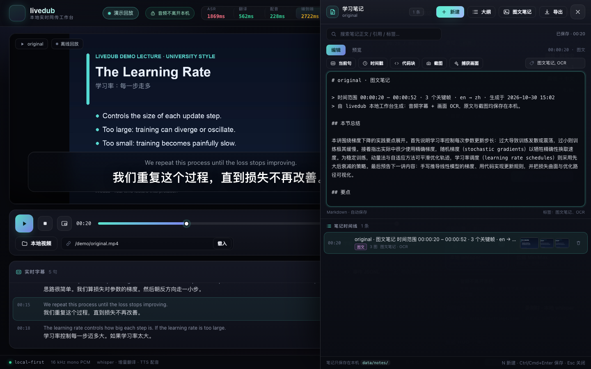
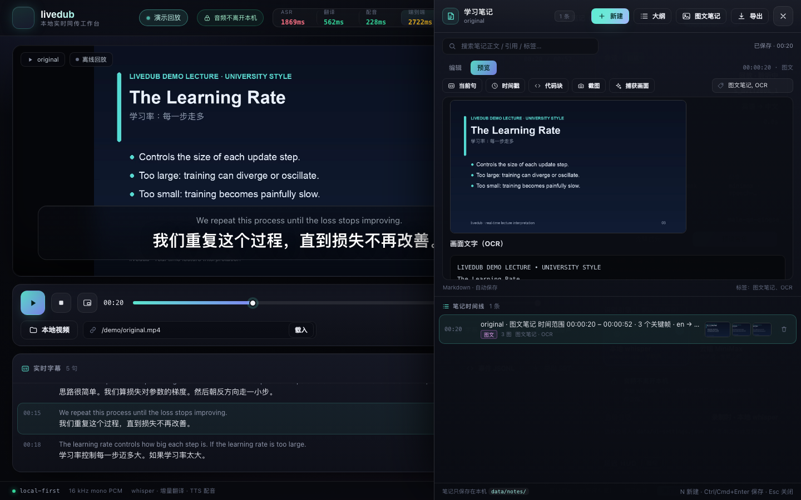

# 边看边实现 + 学习笔记

> 目标：**看视频 → 跟着实现（敲代码）→ 随时记笔记**，三者不打断。笔记全部落在本机 `data/notes/`，可一键导出 Markdown（Obsidian / Typora / GitHub 均可读）。

## 三种用法，按你的工作流选

### 1) 工作台里边看边写（`/studio/`）

```bash
npm start
# http://127.0.0.1:8787/studio/ → 侧栏「学习笔记」
```

- **时间戳笔记**：按 `N` 在当前视频时间新建笔记；列表里点击任意笔记会 **seek 回当时的画面**。

| 笔记抽屉（工作台真实会话） | Markdown 预览 |
|---|---|
|  |  |
- **插入当前句**：一键把当前中英双语字幕 + 时间范围写入 `quotes`，复习时能对照原声。
- **插入截图**：把当前视频帧截成 PNG 存入笔记资产（本地 `data/notes/assets/`）。
- **代码块**：`Ctrl/Cmd+Shift+C` 插入 fenced code block，适合边看边实现时记录关键代码。
- **自动保存** + Markdown 预览；引擎没启动时自动回退 localStorage。
- **生成课程大纲**：按时间轴把本次字幕生成可编辑大纲，再补自己的话。
- **画中画**：按钮把视频切到系统 PiP——你可以切到 VSCode 敲代码，视频悬浮在角落；引擎/字幕/配音不受影响。
- **导出**：
  - 复制 Markdown 到剪贴板；
  - 下载 `.md`（带 YAML front matter：title/url/date/lang）；
  - 写入 `data/exports/<课程>-<日期>.md`（方便 Obsidian 直接打开目录）。

### 2) 外部编辑器里边看边写：全局快捷键（Chrome 扩展 / macOS App）

- **Chrome 扩展**：网页视频里按 `Alt+Shift+N`（或浮层面板「记笔记」）→ 记录当前句双语字幕 + `mm:ss` +（可选）页面截图到笔记库；全屏/停止抓音后仍可用。
- **macOS 桌面 App**：任意应用/播放器上方按 `⌥N` → 记录当前句双语字幕 + 时间 +（可选）屏幕截图；菜单栏可「打开笔记」。
- 场景：视频在浏览器/播放器，你在 VSCode 里跟着实现，按快捷键记下「这行为什么这么写 / 这里我不懂」，不用切窗口。

```bash
# Chrome 扩展
chrome://extensions → 开发者模式 → 加载已解压 → livedub/extension
# macOS App
bash scripts/build-macos.sh && open apps/macos/build/livedub.app   # 首次授权屏幕录制
```

### 3) 终端 / 脚本 / 任意编辑器（CLI）

```bash
node scripts/note.mjs "反向传播 = 链式法则 + 计算图"
node scripts/note.mjs "这行 detach 的原因？" --video "MIT 6.S191 Lecture 2" --time 12:34 --tag todo
node scripts/note.mjs "对比三种优化器" --video "CS231n" --time 3:20 --screenshot /tmp/frame.png
npm run note -- "用 npm script 也可以"
```

- 引擎在线：写入引擎笔记库（`POST /api/notes/quick`）。
- 引擎未启动：自动追加到 `data/notes/quick-YYYY-MM-DD.md`（离线可用，Obsidian 可直接打开）。
- 给编辑器/终端配快捷键：iTerm/Tmux/Alfred/Raycast 里绑 `node livedub/scripts/note.mjs "..."` 即可。
- 视频标题/URL 决定 `video.id`，同一视频的所有笔记会聚合在一起。

## 图文笔记：画面理解（v0.5）

不只是记字幕：笔记可以同时包含**视频画面理解 + 音频字幕 + 综合总结**。

- **工作台「图文笔记」**（笔记抽屉）：
  1. 选范围（当前时间→结尾 / 全片）；
  2. 自动按画面变化抽**关键帧**（默认每 6s 采样、64×36 灰度差异去重、最多 24 帧）；
  3. 默认跑**本地 OCR**（macOS Vision，约 1s/帧，离线、免费）提取幻灯片/代码/板书文字；
  4. 可选「画面理解（VLM，慢 ~20-30s/批）」对拼图画面做中文语义描述（默认关闭，产生模型费用）；
  5. 用文本模型把「范围内字幕 + 画面文字 + 画面描述」合成**本节总结 + 要点 + 按时间线的图文条目**，保存为一篇 `kind:'visual'` 笔记；
  6. 每条包含：时间跳转链接、画面截图、画面文字（代码块）、画面理解（可选）、该时段双语字幕引用。

  **实测**（M2/16GB，demo 53s 片段）：范围 00:20–00:52 → 7 个候选点、去重后 3 个关键帧，真实 macOS Vision OCR + DeepSeek 总结，
  全程约 **10s**，生成 2081 字图文笔记（3 张截图）。OCR serve 模式实测首帧 0.65–1.5s、后续 0.2–1.5s；VLM 单帧 20.3–21.9s（可选）。

  | 图文笔记（真实 OCR + 真实总结） | 图文预览/画廊 |
  |---|---|
  |  |  |
- **快捷笔记**（扩展 `Alt+Shift+N` / macOS `⌥N`）：截图上传后自动做 OCR，把「画面文字」追加到笔记正文（VLM 可选关闭/开启）。
- **CLI**：`npm run note -- "..." --screenshot frame.png` 自动带画面文字；加 `--vision` 额外做画面理解（慢）。

配置（`config/livedub.config.json` → `vision`）：

```json
{
  "vision": {
    "provider": "ark-plan",
    "model": "doubao-seed-2-1-turbo-260628",
    "prompt": "你是课程笔记助手……",
    "ocr": { "provider": "macos-vision", "bin": "data/bin/ocr-macos", "fallback": ["tesseract"] },
    "summary": { "provider": "deepseek", "model": "deepseek-flash" },
    "keyframe": { "intervalMs": 6000, "minChange": 0.035, "maxFrames": 24, "sheetSize": 6 }
  }
}
```

- 本地 OCR 构建：`npm run build:ocr`（Swift + macOS Vision，产物 `data/bin/ocr-macos`）；没有时回退 `tesseract`（仅 eng）。
- VLM 走 OpenAI 兼容视觉接口（默认 ark-plan / doubao，可换任意兼容 provider）；未配置 Key 时只有 OCR，不影响笔记保存。

## 数据与隐私

```
data/notes/
  <videoSlug>.json          # 该视频的笔记（Markdown + 时间戳 + quotes + 标签 + 截图引用）
  quick-YYYY-MM-DD.md       # 快捷笔记的每日追加文件（Obsidian 友好）
  assets/<id>.png           # 截图
data/exports/<课程>-<日期>.md  # 手动导出的完整笔记
```

- 笔记**只落本机** `data/`（已 gitignore），不上传任何服务；`/api/notes` 只在 `127.0.0.1` 提供。
- 不写密钥；导出文件可直接放进 Obsidian/Notion 的 Git 仓库。

## 推荐的「边看边实现」节奏

1. 视频开**画中画**，旁边开 VSCode，边照抄/改造边理解；
2. 遇到关键概念或坑，按 `Alt+Shift+N` / `⌥N` / CLI 快捷键记一句（自动带双语原句和时间）；
3. 停下的地方在工作台写详细笔记 + 代码块 + 截图；
4. 用「生成课程大纲」整理成章，导出 Markdown 进 Obsidian；
5. 复习时点笔记时间戳直接跳回原视频对应位置。

## API（自建工具/插件可调用）

见 [docs/CONTRACTS.md](CONTRACTS.md) §7.6「笔记 API」。核心：

- `GET /api/notes?videoId=&q=`
- `POST /api/notes` / `PUT /api/notes/:id` / `DELETE /api/notes/:id`
- `POST /api/notes/quick`（快捷追加）
- `POST /api/notes/assets`（PNG）
- `GET /api/notes/export.md?videoId=`、`POST /api/notes/export`（写文件）

## 常见问题

- **截图失败**：本地文件/同源视频可直接 canvas 截帧；跨域视频（远程 URL）会受 CORS 限制，用扩展的「附页面截图」或 macOS App 的屏幕截图代替。
- **画中画没反应**：Safari/Chrome 对 `requestPictureInPicture` 支持不同，按钮会给出提示；也可用系统级 PiP。
- **笔记没出现在另一台设备**：默认本地存储（本地优先），同步请把 `data/notes/` 放进你自己的同步盘/Git。
