# livedub usage reference

This page holds the operational detail moved out of the main README: installation, every npm script,
the three capture surfaces, provider and voice-clone setup, notes workflows, the screenshot gallery,
and troubleshooting.

The maintained README pair is [README.md](../README.md) (English) and
[README.zh-CN.md](../README.zh-CN.md) (Chinese). The earlier English overview remains at
[README.en.md](../README.en.md) for history. Existing design and measurement documents under `docs/`
are written mostly in Chinese.

## 1. Requirements

| Component | Requirement | Notes |
|---|---|---|
| OS | macOS (primary) | The desktop overlay needs macOS 14+; Linux is used only for CI tests |
| Node.js | **≥ 22** | `package.json` sets `"node": ">=22.0.0"`; CI runs 22 and 24 |
| Media tools | `ffmpeg`, `ffprobe` | `brew install ffmpeg`; used by batch mixing and muxing |
| Local ASR | `whisper-server` + ggml model | `brew install whisper-cpp`; default model `models/ggml-large-v3-turbo-q5_0.bin` (about 547 MB) |
| Swift | 5.10+ Command Line Tools | Only for `apps/macos/`; full Xcode is not required |
| Chrome | 116+ | Extension uses MV3 offscreen documents and `runtime.getContexts` |
| Provider keys | Translation + TTS | Read read-only from `~/.sayless/config.json`, config `providers`, or `LIVEDUB_PROVIDER_<NAME>_API_KEY` |

The fast profile needs a second model:

```sh
curl -L -o models/ggml-small.bin \
  https://huggingface.co/ggerganov/whisper.cpp/resolve/main/ggml-small.bin
```

## 2. Install and first run

```sh
git clone https://github.com/LeoLin990405/livedub.git
cd livedub
brew install ffmpeg whisper-cpp
mkdir -p models
curl -L -o models/ggml-large-v3-turbo-q5_0.bin \
  https://huggingface.co/ggerganov/whisper.cpp/resolve/main/ggml-large-v3-turbo-q5_0.bin

npm run doctor          # read-only; --probe makes one small real provider request
npm test                # offline unit and mock end-to-end suites
npm start               # engine + studio at http://127.0.0.1:8787/studio/
```

`npm run studio` starts the same engine and opens the browser. The engine binds to `127.0.0.1:8787`
and accepts WebSocket origins from `chrome-extension://*`, `http://127.0.0.1`, and
`http://localhost` only.

## 3. Command reference

| Script | Command | Purpose |
|---|---|---|
| `npm start` | `node engine/server.mjs` | Engine, studio, Notes API, replay server |
| `npm run studio` | same with `--open` | Start and open the studio |
| `npm run doctor` | `node scripts/doctor.mjs` | Read-only environment and provider check |
| `npm test` | `node --test tests/*.test.mjs` | All offline tests |
| `npm run test:core` | core + pipeline tests | Faster engine-focused subset |
| `npm run lint` | `node scripts/lint.mjs` | Syntax check for every JS file |
| `npm run check` | lint + tests | Pre-commit aggregate |
| `npm run batch` | `node scripts/batch.mjs` | Real pipeline over `demo/original.mp4` |
| `npm run demo:video` | `node scripts/make-demo.mjs` | Generate the synthetic English lecture |
| `npm run demo:batch` | alias of `batch` | Demo pipeline |
| `npm run start:fast` | `LIVEDUB_PROFILE=fast` engine | Local whisper `small` profile |
| `npm run batch:fast` | fast profile, `--out demo-fast --no-burn` | Fast-profile artifacts |
| `npm run demo:fast` | fast profile, `--out demo-fast` | Fast-profile artifacts with burn-in |
| `npm run start:cloud` | `LIVEDUB_PROFILE=cloud` engine | `stream-cloud` ASR with local fallback |
| `npm run batch:cloud` | cloud profile, `--out demo-cloud --no-burn` | Cloud-profile artifacts |
| `npm run demo:cloud` | cloud profile, `--out demo-cloud` | Cloud-profile artifacts with burn-in |
| `npm run note -- "..."` | `node scripts/note.mjs` | Quick note from the terminal |
| `npm run note:vision -- "..."` | note with screenshot | Quick note plus OCR/VLM attachment path |
| `npm run start:notes` | engine with `--open` | Start and open the studio notes view |
| `npm run build:macos` | `bash scripts/build-macos.sh` | Build `apps/macos/build/livedub.app` |
| `npm run test:macos` | `node --test tests/macos.test.mjs` | Static macOS contract tests (cross-platform) |
| `npm run build:ocr` | `bash scripts/build-ocr.sh --check` | Check/build the local Vision OCR helper |

## 4. Profiles

`LIVEDUB_PROFILE` selects an override file that is layered over `config/livedub.config.json`:

| Profile | Command | ASR backend | Measured end-to-end |
|---|---|---|---|
| Quality (default) | `npm start` / `npm run batch` | local `whisper-server`, `large-v3-turbo-q5` | 3001 ms median |
| Fast | `npm run start:fast` / `npm run batch:fast` | local whisper `small` | 2389 ms median |
| Cloud | `npm run start:cloud` / `npm run batch:cloud` | `stream-cloud`, fallback `whisper-local` | not re-measured for this chain |

`config/livedub.fast.json` swaps the model candidate list to `ggml-small` first.
`config/livedub.cloud.json` sets `asr.provider` to `stream-cloud`, `asr.fallback` to `whisper-local`,
and enables translation draft reuse.

**Cloud caveat.** The 2204 ms and 2385 ms cloud figures in [MEASUREMENTS.md](MEASUREMENTS.md) were
measured with the earlier MiniMax `asr-1.0` upload provider (two runs of the same 52.7 s clip). The
current cloud profile uses a single streaming recognizer and falls back to local whisper on failure.
The repository does not publish a measured end-to-end number for that new chain.

## 5. Surfaces

### 5.1 Studio workbench

```sh
npm start
# http://127.0.0.1:8787/studio/
```

- Accepts a local course video, a direct media URL, or a pasted course page.
- Direct `mp4` / `webm` / `mp3` URLs go to the player.
- Course pages are fetched by the local engine through `POST /api/page/parse`. YouTube and Bilibili
  yield a title and timed captions, not a playable video file; the extension is still used for their
  audio.
- Shows a latency HUD, glossary editor, voice mode, bilingual SRT export, and event replay.
- Keyboard: `⌘K` command palette, `?` shortcut help, `N` new note, Tab rail for subtitles / notes /
  settings. Below 1100 px the dock becomes an overlay; below 720 px the layout is single-column.

Replay a recorded session without rerunning the pipeline:

```sh
npm start
# http://127.0.0.1:8787/replay/?session=/demo/session.jsonl&video=/demo/original.mp4
```

### 5.2 Chrome extension

1. Start the engine (`npm start`).
2. Open `chrome://extensions`, enable **Developer mode**, click **Load unpacked**, select
   `extension/`.
3. Open a video page, click the toolbar icon, then click **Start**. `tabCapture` must run inside that
   user gesture; the `Alt+Shift+L` command also starts/stops a session.

Permissions used:

| Permission | Why it is needed |
|---|---|
| `tabCapture` | Capture the current tab's audio; must be called from a user gesture |
| `offscreen` | Run `getUserMedia`, AudioWorklet, WebSocket, and dub playback outside the service worker |
| `storage` | Persist settings in `storage.local` and session state in `storage.session` |
| `activeTab` | Inject or message the overlay after a user click |
| `scripting` | Fallback injection for tabs opened before the extension loaded |

The extension has no remote code, CDN assets, or inline scripts. `host_permissions` are limited to
`http://127.0.0.1/*` and `http://localhost/*`. `extension/preview/` contains offline UI fixtures with
a Chrome stub; it is not loaded by the manifest. Details and the manual test list are in
[extension/README.md](../extension/README.md).

### 5.3 macOS overlay

```sh
bash scripts/build-macos.sh          # compile + ad-hoc sign
open apps/macos/build/livedub.app
bash scripts/build-macos.sh --check  # compile + headless self-test
```

- Captures the display audio mix with ScreenCaptureKit; it does not capture a single app yet.
- Shows a non-activating `NSPanel` with the translated line, source line, state pill, and latency.
- Plays PCM dub chunks through `AVAudioEngine` ordered by `startMs`.
- Requires **Screen Recording** permission in System Settings → Privacy & Security. The app polls the
  permission and starts capture after it is granted.
- Rebuilding with ad-hoc signing changes the cdhash, so macOS may ask for the permission again.
- Global `⌥N` records the current bilingual line plus timestamp and an optional screenshot.

Known platform limits:

1. System audio is captured, not replaced, so the original and dub play together.
2. The app is ad-hoc signed and not notarized; Gatekeeper may require right-click → Open.
3. ScreenCaptureKit captures the display mix, not a single application.
4. A logged-in graphical session is required; SSH/headless runs cannot capture audio.
5. DRM-protected audio may not be capturable.
6. The overlay shows only the current sentence; history and SRT export live in the studio/extension.
7. There is no auto-update or launch-at-login UI; `--autostart` exists for login items.

Full build, menu, protocol, and acceptance notes: [apps/macos/README.md](../apps/macos/README.md).

### 5.4 Offline batch

```sh
npm run demo:video   # demo/original.mp4
npm run batch        # real ASR -> translation -> TTS -> mix
```

Outputs:

| File | Contents |
|---|---|
| `demo/dubbed.mp4` | Original ducked to 18% under the dub, Chinese voice, burned bilingual subtitles |
| `demo/bilingual.srt` | Bilingual subtitles for any player |
| `demo/session.jsonl` | Engine event stream for the replay page |
| `demo/metrics.json` | Per-sentence ASR / first token / first TTS packet / end-to-end latency |
| `demo/demo-meta.json` | Slide timeline and narration text for the synthetic clip |

The batch path re-times dub chunks to `sentence start + ~320 ms`, keeps them non-overlapping, and
uses TTS speed 1.15 to compensate for Chinese being 5–15% longer than English. The demo's dub ends at
52.1 s for a 52.7 s video, with no clipped final sentence.

## 6. Providers and voice cloning

Configuration precedence, low to high:

1. `config/livedub.config.json`;
2. `~/.sayless/config.json` → `providers.<name>` (read-only, never rewritten);
3. environment variables such as `LIVEDUB_PROVIDER_<NAME>_API_KEY`, `LIVEDUB_TRANSLATE_PROVIDER`,
   `LIVEDUB_TTS_PROVIDER`, `LIVEDUB_WHISPER_MODEL`, `LIVEDUB_PORT`;
4. session `hello.overrides`.

| Capability | Provider | Notes |
|---|---|---|
| ASR | `whisper-local` | Local `whisper-server`, model list in `asr.whisper.models` |
| ASR | `minimax-cloud` | Whole-segment upload, `POST /v1/speech_to_text`, `model=asr-1.0` |
| ASR | `stream-cloud` | Streaming recognizer used by the cloud profile; falls back to local whisper |
| ASR | `mock` | Test signal without model or network |
| Translation | `deepseek` | OpenAI-compatible streaming, default `deepseek-flash` |
| Translation | `minimax` | OpenAI-compatible, `MiniMax-M3` |
| Translation | `mimo-plan`, `zai`, `ark-plan` | Additional OpenAI-compatible fallbacks |
| TTS | `minimax` | `speech-2.8-hd`, PCM/SSE streaming, preset system voices |
| TTS | `macos-say` | System `say` with `Tingting` and other voices; offline fallback |
| TTS | `mock` | Sine-wave test tone |
| Clone | MiniMax pay-as-you-go | `/v1/files/upload` + `/v1/voice_clone`; Token Plan returns 2061 |
| Clone | Volcengine v3 | `POST /api/v3/tts/voice_clone`; needs a Doubao Speech UUID key |

`clone-first` collects lecturer audio (minimum 12 s by default), tries `tts.clone.chain`, switches to
the cloned voice on success, and on failure records one reason and falls back to `tts.presetVoices`.
Set `voiceMode: "preset"` to skip cloning entirely.

MiniMax cloning requirements: 10 s–5 min audio, mp3/m4a/wav, ≤20 MB. Volcengine requires a UUID API
key from the Doubao Speech console; an Ark `ark-` key is rejected with 401.
[PROVIDERS.md](PROVIDERS.md) has the full matrix and setup steps.

## 7. Notes and visual notes

All note data stays local under `data/notes/`:

```text
data/notes/
  <videoSlug>.json          # note document: timestamps, quotes, tags, screenshots
  quick-YYYY-MM-DD.md       # daily quick-note append file (Obsidian-friendly)
  assets/<id>.png           # screenshots
data/exports/<course>-<date>.md
```

### 7.1 Four ways to record

- **Studio:** `N` creates a note at the current video time; the note list seeks back on click. The
  editor supports current-line quotes, code blocks, screenshots, Markdown preview, and PiP.
- **Chrome extension:** `Alt+Shift+N` records the current bilingual line, `mm:ss`, and an optional
  page screenshot. Notes queue offline (max 50) and flush when the engine is reachable.
- **macOS overlay:** `⌥N` records the current line, session timestamp, and an optional screenshot.
  The offline queue is also capped at 50 and flushes on reconnect or every 60 s.
- **CLI:** `npm run note -- "..."` supports `--video`, `--time`, `--tag`, and `--screenshot`; add
  `--vision` for the slow VLM path. With no engine running it appends to
  `data/notes/quick-YYYY-MM-DD.md`.

### 7.2 Visual notes

1. Choose a range (current time to end, or the whole video).
2. Sample keyframes every 6 s and deduplicate with a 64×36 grayscale diff (`minChange` 0.035,
   max 24 frames).
3. Run local macOS Vision OCR (about 1 s per frame, offline); fall back to tesseract with English
   only. Build the helper with `npm run build:ocr`.
4. Optionally run the VLM caption path through an OpenAI-compatible vision endpoint. It is off by
   default and takes roughly 20–30 s per frame.
5. Summarize transcript + OCR text + optional captions into a visual note with a summary, bullet
   points, and a timeline of screenshots, screen text, and bilingual quotes.

Observed on the reference M2 host: a 3-frame demo visual note takes about 10 s end to end with real
OCR and a real DeepSeek summary. These are single-machine observations, not benchmarks.

### 7.3 Chapters and course overview

Chapter mode splits on caption gaps over 2.5 s or frame changes (snapped within ±2 s), keeps chapters
between 20 s and 180 s, and caps at 30 chapters. It generates one visual note per chapter and then a
`kind:'outline'` course overview with `hh:mm:ss` anchors. On the 52 s demo this produced 2 chapter
notes plus 1 overview, 7 screenshots, in about 42 s.

### 7.4 Obsidian export

```json
{
  "notes": {
    "obsidian": {
      "enabled": true,
      "dir": "~/Obsidian/course-notes",
      "assetsSubdir": "livedub-assets",
      "autoExport": true
    }
  }
}
```

Export writes one Markdown file per course (YAML front matter with title, URL, date, language,
source, tags, time anchors), copies screenshots into `<vault>/livedub-assets/`, rewrites image paths
relative to the vault, and maintains `livedub-notes-index.md`. With `autoExport`, note create/update/
delete operations sync after a ~1 s debounce. Sync failure does not block note saving.

### 7.5 Visual context for translation

The studio (every 9 s) and macOS app (every 10 s) can push OCR text over WebSocket as
`visual-context`. The engine keeps the latest entry for 120 s, deduplicates identical frames, and
injects it into the translation prompt only as terminology/context. Enabling this sends screen text
to the configured translation provider; leave it off for sensitive screens.

### 7.6 Notes API

| Endpoint | Purpose |
|---|---|
| `GET /api/notes?videoId=&q=` | List/search notes |
| `POST /api/notes` | Create a note |
| `PUT /api/notes/:id`, `DELETE /api/notes/:id` | Update or delete |
| `POST /api/notes/quick` | Append a quick note |
| `POST /api/notes/assets` | Upload a PNG asset |
| `GET /api/notes/export.md?videoId=` | Render Markdown |
| `POST /api/notes/export` | Write Markdown under `data/exports/` |

The full request/response contract is in [CONTRACTS.md](CONTRACTS.md) §7.6.

## 8. Course-page parsing

Pasting an `http(s)` course page sends it to the local engine (`POST /api/page/parse`). The browser
does not fetch third-party pages directly.

- Plain pages: title, directly playable media, `<track>` elements, and `.vtt` / `.srt` captions.
- YouTube / Bilibili: title and timed captions only. Encrypted streams and DASH manifests are not
  passed to the player; dub audio still comes from the extension's tab capture.
- Text without timestamps is not converted into subtitles and cannot align speech with slides.

## 9. Screenshot gallery

All screenshots below are real artifacts from the repository's `docs/assets/` directory.

| Studio v0.7 dark | Studio v0.7 light |
|---|---|
| 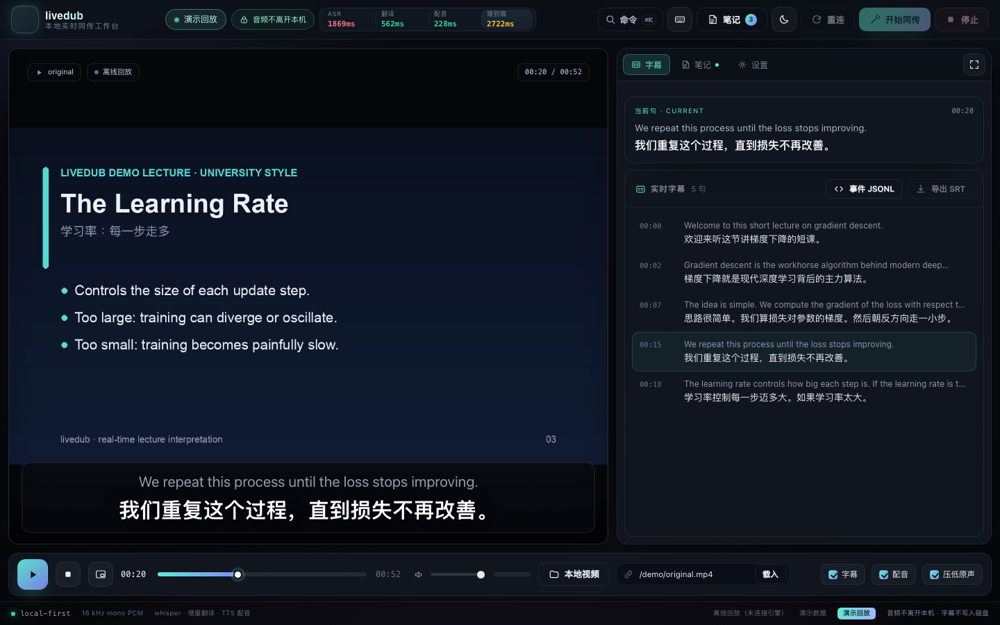 | 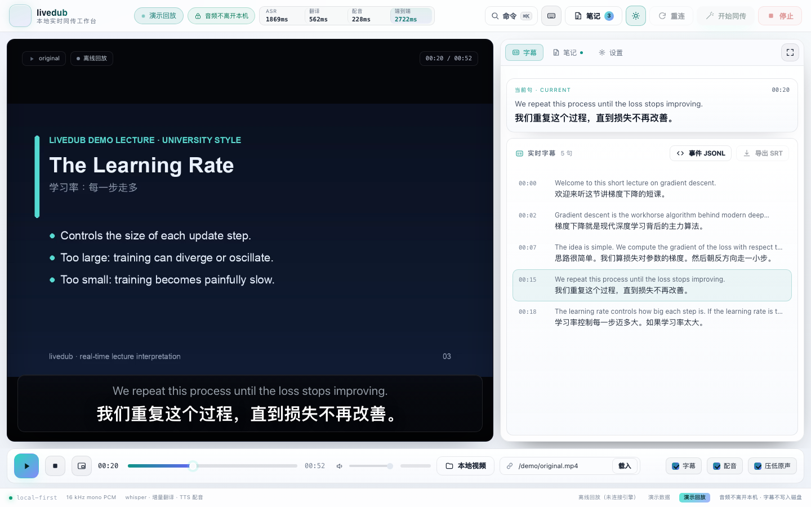 |

| Notes workspace | Command palette |
|---|---|
| 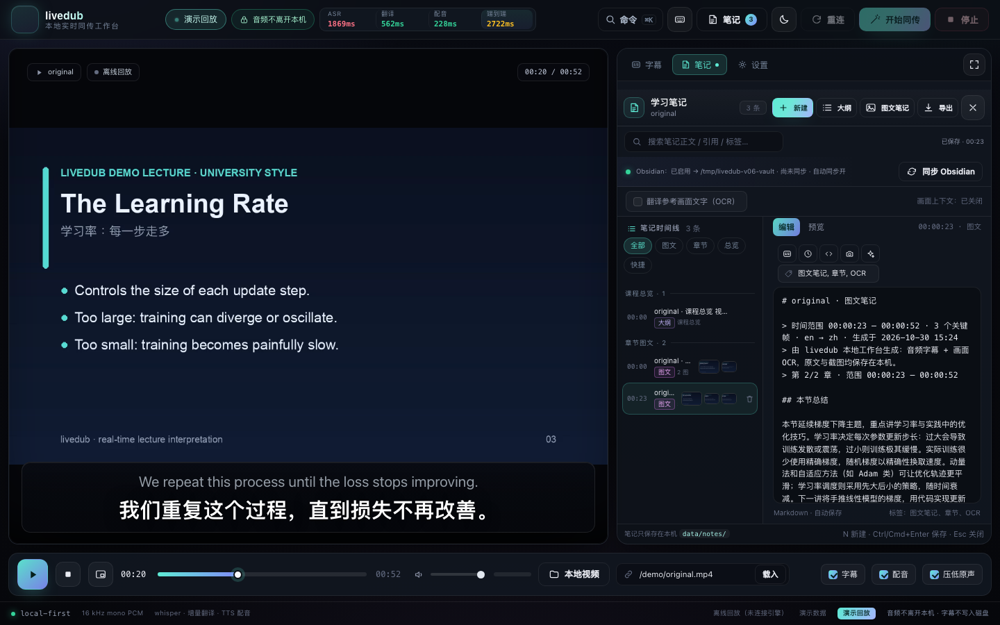 | 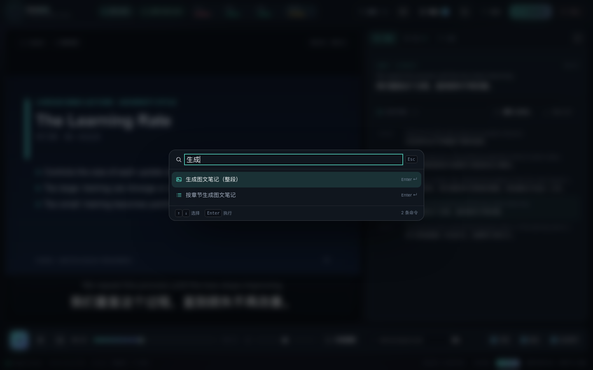 |

| Narrow layout (390×844) | Replay page |
|---|---|
| 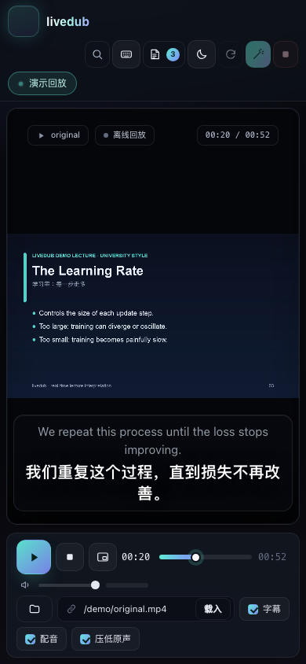 | 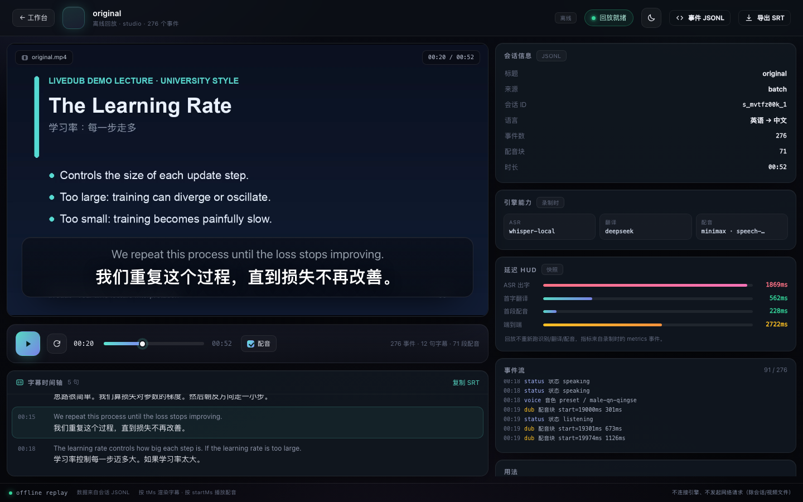 |

| Chrome subtitle overlay | Chrome popup |
|---|---|
| 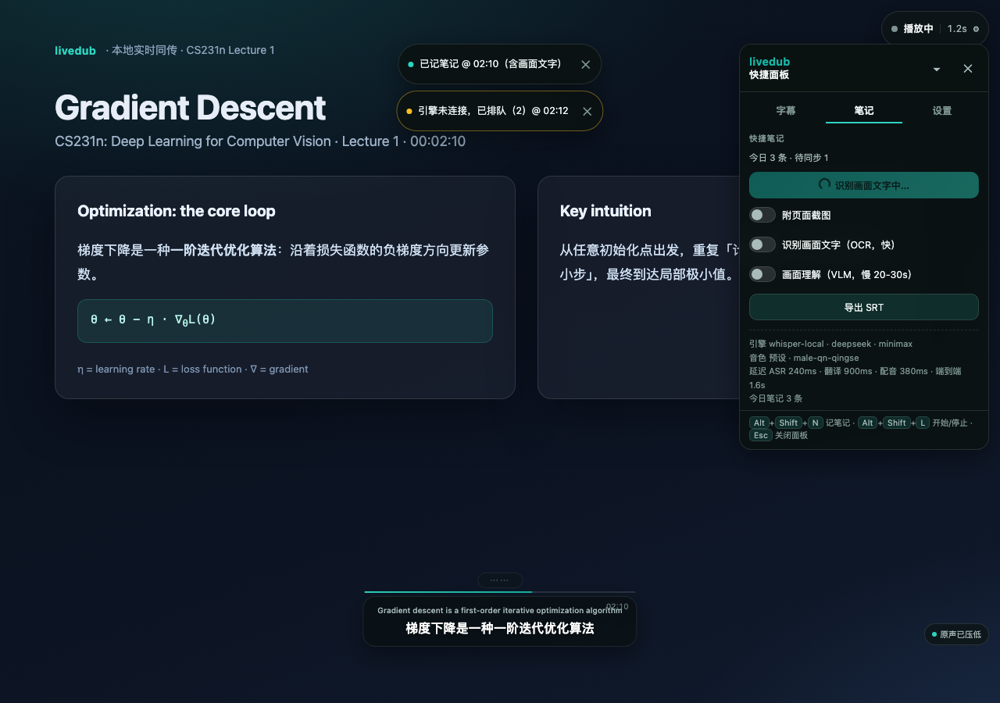 | 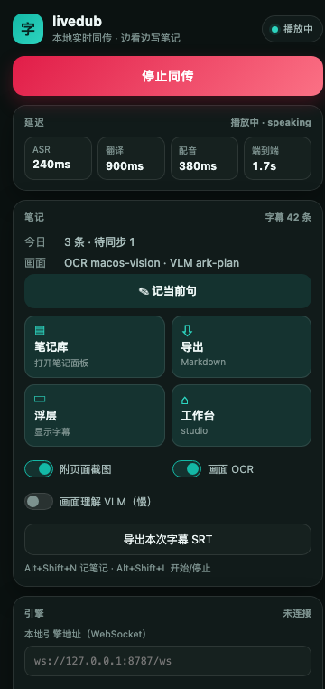 |

| macOS overlay | macOS settings |
|---|---|
| 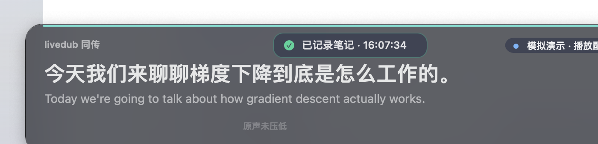 | 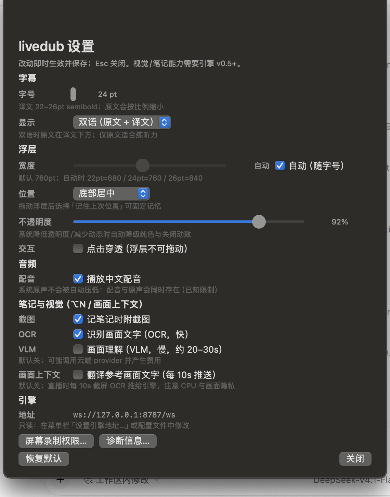 |

| Generation progress | Dubbed output frame |
|---|---|
| 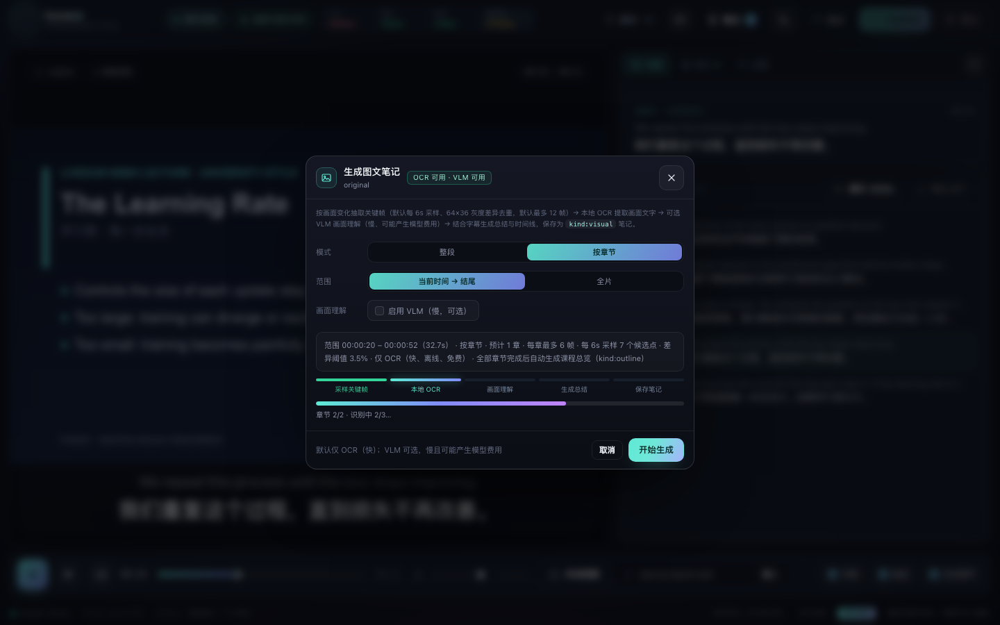 | 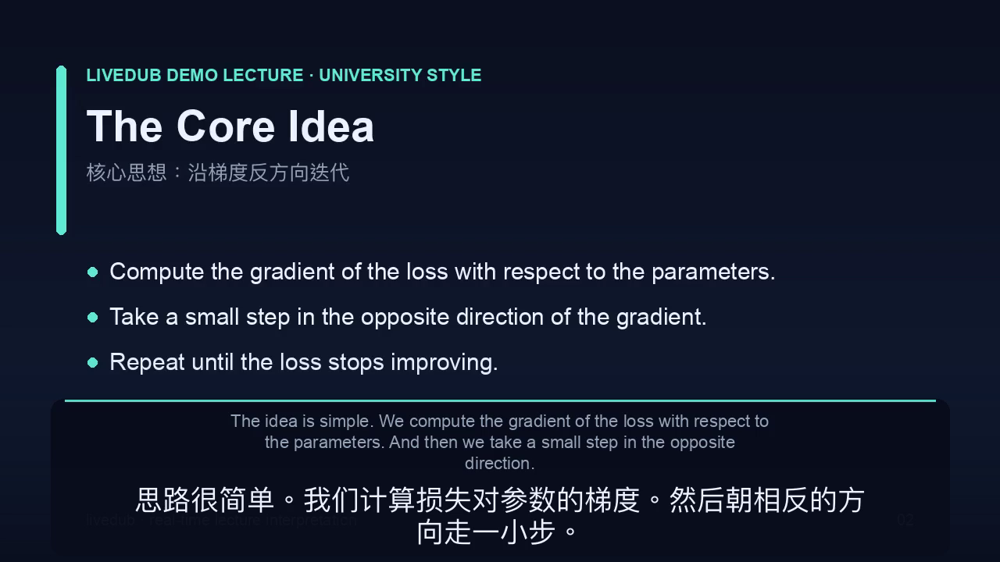 |

| Studio notes drawer | Markdown preview |
|---|---|
| 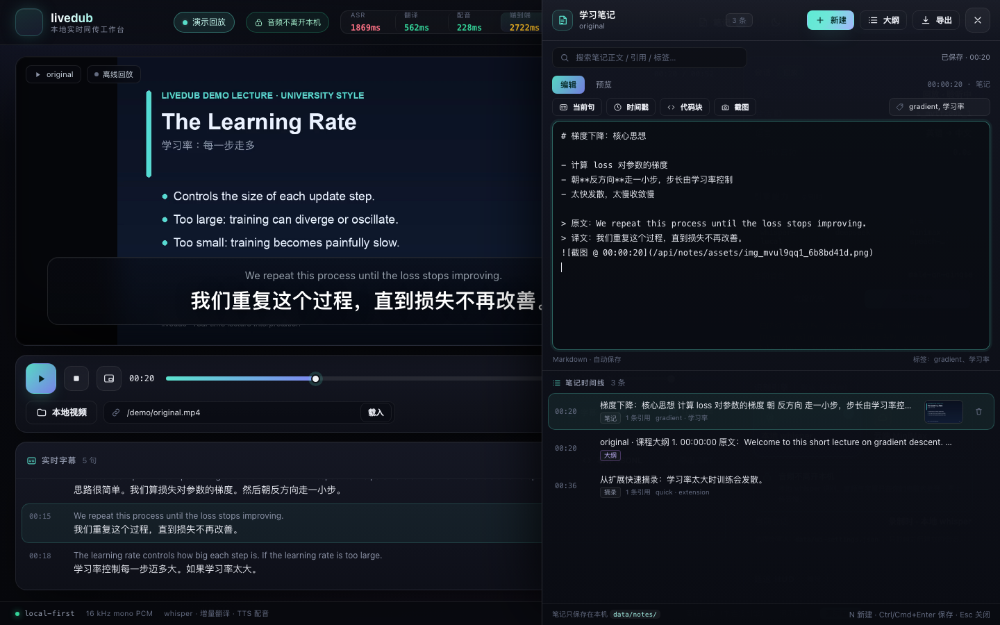 | 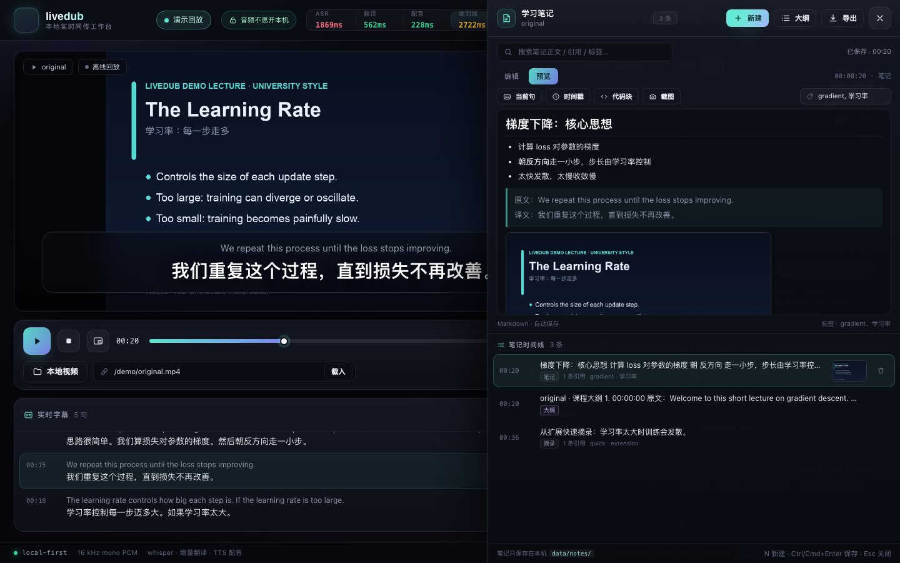 |

| Visual note | Visual gallery |
|---|---|
| 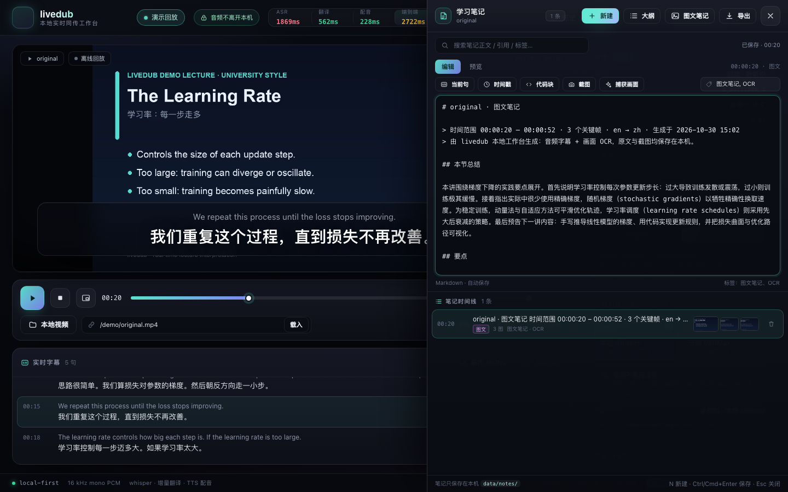 | 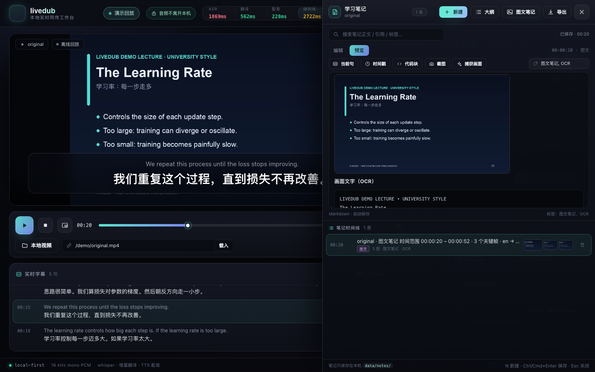 |

| Chapter note | Course overview |
|---|---|
| 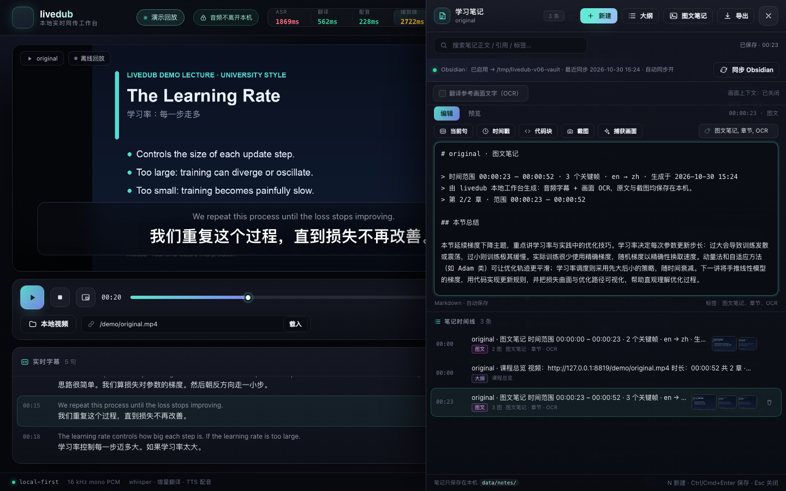 |  |

| Obsidian sync status |
|---|
| 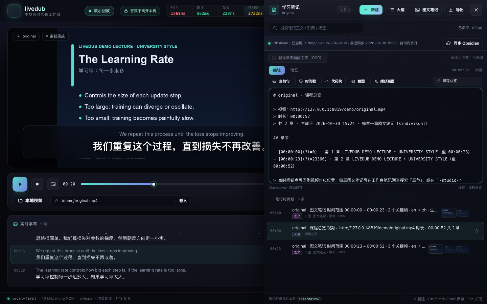 |

Additional real-session captures: `docs/assets/studio-real-session.png`,
`docs/assets/replay-real-session.png`, `docs/assets/demo-original.png`.

## 10. Troubleshooting

| Symptom | What to check |
|---|---|
| `provider "deepseek" 缺少 apiKey` | Key missing from `~/.sayless/config.json` or the environment; run `npm run doctor` |
| TTS returns 2061 | Token Plan does not allow voice clone; the preset fallback is expected |
| whisper takes 20–30 s to become ready | Cold start and Metal shader cache; later utterances use the resident model |
| Subtitles appear but no dub | Inspect `error(tts)` and run `npm run doctor --probe`; verify the TTS key and voice ID |
| Extension captures no audio | DRM/protected page, or `tabCapture` was not called inside a click; try a normal video page |
| Engine keeps reconnecting | Confirm `npm start` is running on `127.0.0.1:8787`; check `lsof -i :8787` |
| Extension overlay missing | Refresh the page so the content script injects; check the overlay is not hidden |
| macOS overlay shows "waiting for Screen Recording" | Grant the permission to livedub (or the launching terminal), then reopen the app |
| macOS overlay cannot start the engine | The app looks for `~/livedub` or `LIVEDUB_ROOT`; verify `node` is on `PATH` |
| Visual notes have no OCR text | Check `npm run build:ocr` and `/api/vision/health`; OCR needs a visible-text frame |
| Visual notes have no screenshot | Screenshot capture needs the Screen Recording permission and can fail on DRM content |
| Obsidian sync does not run | Verify `notes.obsidian.enabled`, the vault path, and write permission |

## 11. Privacy and local data

- **Audio.** Local whisper keeps audio in memory. The cloud profile uploads audio to the configured
  remote ASR service; the default profile does not persist audio (`privacy.persistAudio=false`).
- **Text.** Translation text and TTS text go to the configured cloud providers. The engine never
  writes API keys to disk and never logs them.
- **Notes.** Note files and screenshots live under `data/notes/` and are gitignored. They are served
  only on `127.0.0.1`.
- **Visual context.** OCR text is pushed only when the user enables it. VLM captioning can upload
  screenshots to the configured vision provider and may incur charges.
- **Engine boundary.** The HTTP/WS server binds to `127.0.0.1`; static files are limited to
  `studio/` and `demo/`; `/api/config` responses are scrubbed. See [SECURITY.md](../SECURITY.md).

## 12. Documentation index

| Document | Contents |
|---|---|
| [README.md](../README.md) | English overview, quick start, features, limits |
| [README.zh-CN.md](../README.zh-CN.md) | Chinese mirror of the overview |
| [README.en.md](../README.en.md) | Earlier English overview, kept for history |
| [CONTRACTS.md](CONTRACTS.md) | Wire protocol, provider interfaces, audio format, notes API |
| [ARCHITECTURE.md](ARCHITECTURE.md) | Process topology, timing, module design, failure isolation |
| [MEASUREMENTS.md](MEASUREMENTS.md) | Per-profile latency medians, per-sentence table, failed experiments |
| [PROVIDERS.md](PROVIDERS.md) | Provider matrix, cloning setup, cloud ASR details |
| [NOTES.md](NOTES.md#图文笔记画面理解v05) | Notes workflows, visual notes, chapters, Obsidian sync |
| [DESIGN.md](DESIGN.md) | v0.7 design tokens, component rules, accessibility checklist |
| [ROADMAP.md](ROADMAP.md) | Implemented versions, next-stage priorities, explicit non-goals |
| [releases/v0.7.0.md](releases/v0.7.0.md) | v0.7 release notes |
| [CHANGELOG.md](../CHANGELOG.md) | Version history |
| [CONTRIBUTING.md](../CONTRIBUTING.md) | Development setup, conventions, PR checklist |
| [SECURITY.md](../SECURITY.md) | Threat model and private reporting |
| [CODE_OF_CONDUCT.md](../CODE_OF_CONDUCT.md) | Community expectations |
| [demo/README.md](../demo/README.md) | Demo artifacts and replay instructions |
| [apps/macos/README.md](../apps/macos/README.md) | macOS build, permissions, protocol, acceptance notes |
| [extension/README.md](../extension/README.md) | Extension permissions, message flow, manual tests |

Attribution: the engine reuses provider credentials from `~/.sayless/config.json` read-only. sayless
is an independent local voice-engine project; livedub is not affiliated with it. livedub is MIT
licensed ([LICENSE](../LICENSE)); no NOTICE file is included. The bundled demo media is synthetic and
contains no third-party copyrighted content.
